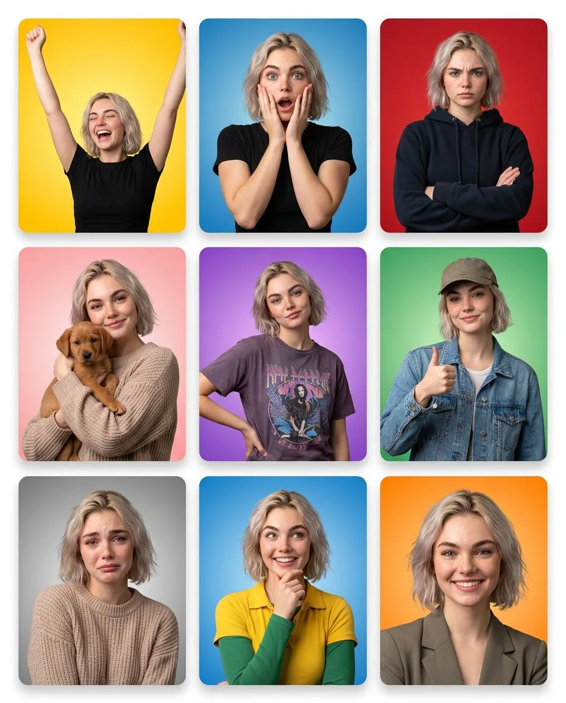

# Kashberg — by @Kashberg_0

[← Back to Examples from X](../../EXAMPLES.md) · Category: Photography · Model: `Nano Banana`

<a href="https://x.com/Kashberg_0/status/2029370003485802945"></a>

Original post: **[@Kashberg_0 on X](https://x.com/Kashberg_0/status/2029370003485802945)** · Creator: [Kashberg](https://x.com/Kashberg_0)

## Prompt

```text
Panels are NOT edge-to-edge
Visible thin white spacing between panels Subtle outer white margin around the entire grid clean modern UI-style layout
Slight rounded corners on each tile
Panel 1 — Joyful / Celebratory (Yellow) Bright yellow gradient background
Arms raised
Eyes closed
Big open laugh
Energetic posture
Panel 2 — Shocked (Blue)
Blue gradient background
Hands on cheeks
Wide eyes
Open mouth
Raised brows
Panel 3 — Serious / Stern (Red)
Red background
Arms crossed
Furrowed brows
Neutral tight lips
Wearing dark hoodie
Panel 4 — Affectionate (Pink)
Soft pink gradient
Holding small brown puppy
Gentle smile
Cozy knit sweater
Panel 5 — Confident / Sassy (Purple)
Purple gradient background
One hand on hip
Slight smirk
Graphic t-shirt
Relaxed stance
Panel 6 — Friendly / Casual Approval (Green)
Green gradient background
Wearing cap + denim jacket
Thumbs-up
Relaxed smile
Panel 7 — Sad / Emotional (Gray)
Gray gradient background
Slight downward gaze
Eyebrows slightly raised in center
Lips slightly curved downward
```

## Try it

Paste the prompt into **[vinano.ai](https://vinano.ai?utm_source=github&utm_medium=readme&utm_campaign=awesome-image-video-prompts-updating&utm_content=x-page-try)** to generate your own version.

> The image and prompt belong to [@Kashberg_0](https://x.com/Kashberg_0) and are shown here with credit for reference. Creators can ask for changes or removal by opening an issue.
