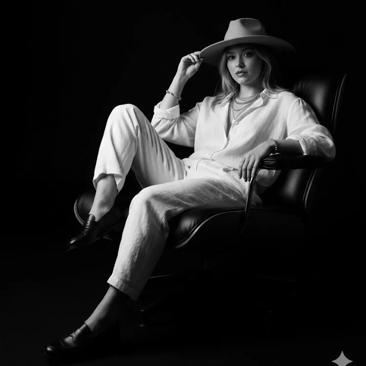

# Cherry 2.O — by @Mind_Boticni

[← Back to Examples from X](../../EXAMPLES.md) · Category: Photography · Model: `Nano Banana`

<a href="https://x.com/Mind_Boticni/status/2013448656767328610"></a>

Original post: **[@Mind_Boticni on X](https://x.com/Mind_Boticni/status/2013448656767328610)** · Creator: [Cherry 2.O](https://x.com/Mind_Boticni)

## Prompt

```text
{
  "prompt": "Hyper-realistic 8K black-and-white studio portrait captured as a medium shot from a slightly low-angle perspective, using a 50mm lens for a natural field of view. The composition features a female subject, 100% using the uploaded face as reference (do not alter facial features or identity), seated off-center to the right, leaving strong negative space above and to the left. She wears a wide-brimmed fedora-style hat, a loose white linen blouse unbuttoned at the collar revealing layered silver necklaces, white linen trousers, and dark leather loafers, with delicate beaded bracelets on both wrists. The subject is seated comfortably in a sleek modern black leather lounge chair, left leg crossed over the right, left hand lightly touching the brim of the hat, and right arm casually resting on the chair’s armrest. Dramatic high-contrast chiaroscuro lighting dominates the scene, with a strong key light from the front-left creating deep shadows and bright highlights that emphasize the detailed textures of the linen fabric, leather chair, felt hat, and hair. Subtle rim lighting outlines the subject and chair, separating them from a pure deep-black background, enhancing cinematic depth and a professional luxury studio photography aesthetic.",
  "color_style": "black and white",
  "resolution": "8K",
  "camera_lens": "50mm",
  "camera_angle": "slightly low-angle",
  "style": "cinematic studio portrait, luxury editorial",
  "lighting": "chiaroscuro, high-contrast studio lighting",
  "reference_image": "strictly use uploaded image only"
}
```

## Try it

Paste the prompt into **[vinano.ai](https://vinano.ai?utm_source=github&utm_medium=readme&utm_campaign=awesome-image-video-prompts-updating&utm_content=x-page-try)** to generate your own version.

> The image and prompt belong to [@Mind_Boticni](https://x.com/Mind_Boticni) and are shown here with credit for reference. Creators can ask for changes or removal by opening an issue.
