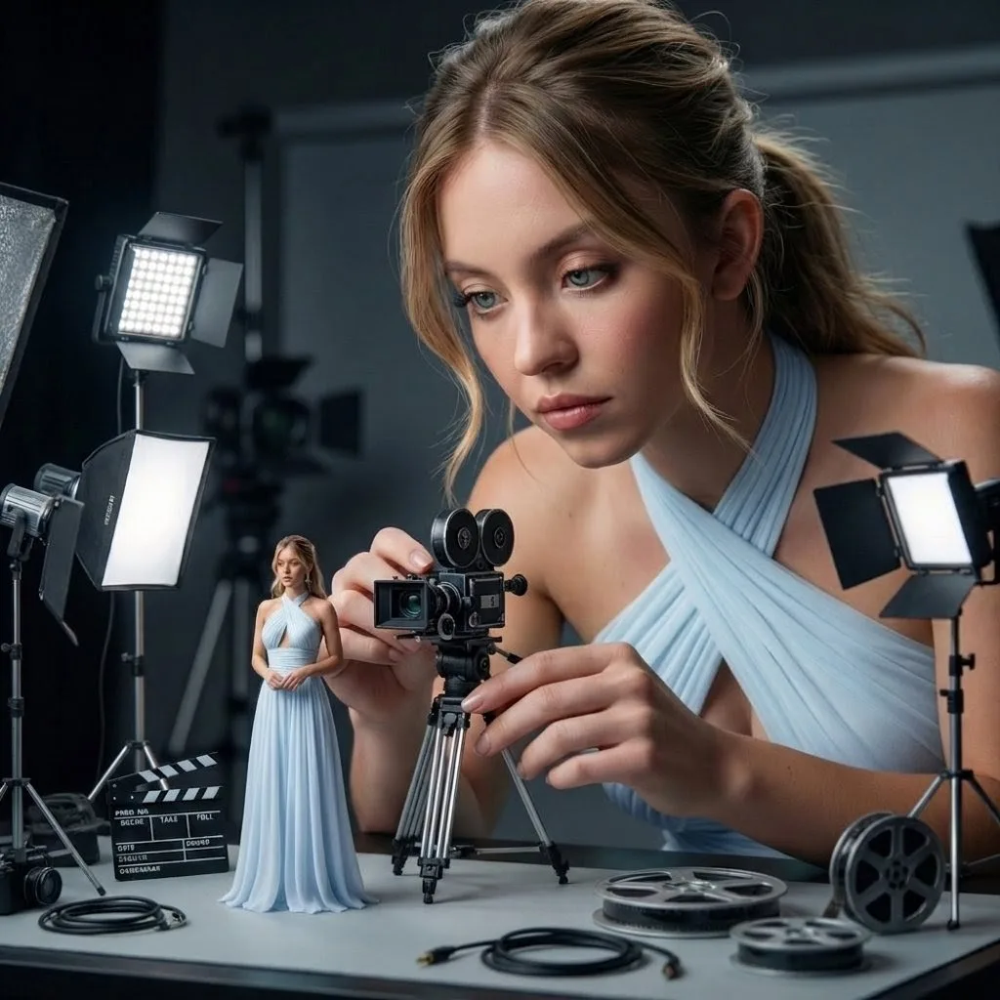

# Synthia — by @AIwithSynthia

[← Back to Community Examples](../../EXAMPLES.md) · Category: Photography · Model: `Nano Banana`

<a href="https://x.com/AIwithSynthia/status/2039602803220591004"></a>

Source: **[@AIwithSynthia on X](https://x.com/AIwithSynthia/status/2039602803220591004)** · Creator: [Synthia](https://x.com/AIwithSynthia)

## Prompt

```text
A hyper-realistic cinematic scene of a giant woman filmmaker carefully adjusting a miniature vintage film camera on a tripod, inside a professional studio setup. A tiny elegant woman in a flowing pastel blue dress stands beside the camera like a model on set. Surrounding them are detailed studio lights, softboxes, film reels, cables, and a clapperboard. The giant woman has soft natural makeup, blonde hair tied back, and an intense focused expression. Dramatic soft lighting, shallow depth of field, ultra-detailed textures, 8K, photorealistic, cinematic composition, studio photography, volumetric lighting.
```

## Try it

Paste the prompt into **[vinano.ai](https://vinano.ai?utm_source=github&utm_medium=readme&utm_campaign=awesome-image-video-prompts-updating&utm_content=x-page-try)** to generate your own version.

> The image and prompt belong to @AIwithSynthia ([original post](https://x.com/AIwithSynthia/status/2039602803220591004)) and are shown here with credit for reference. Creators can ask for changes or removal by opening an issue.
