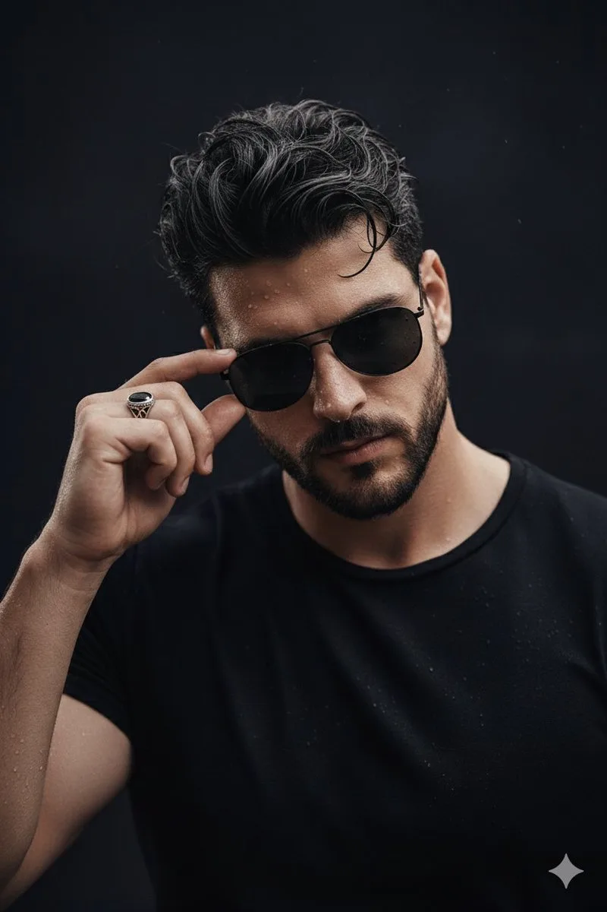

# simeon-sanai — by @Naiknelofar788

[← Back to Community Examples](../../EXAMPLES.md) · Category: Photography · Model: `Nano Banana`

<a href="https://x.com/Naiknelofar788/status/2011283991870259558"></a>

Source: **[@Naiknelofar788 on X](https://x.com/Naiknelofar788/status/2011283991870259558)** · Creator: [simeon-sanai](https://x.com/Naiknelofar788)

## Prompt

```text
Ultra-realistic cinematic close-up portrait of a young man with wet skin and damp, messy hair. He is lightly touching the frame of dark, rectangular aviator sunglasses beaded with clear water droplets. The lighting is low-key and dramatic, creating deep shadows that emphasize the moisture on his skin and the fine texture of his beard. He wears a plain, form-fitting matte black t-shirt that blends into a dark, minimal background. Detailed hand gesture showing defined knuckles and a silver ring with stone on the pinky finger. Razor-sharp micro-details, shallow depth of field, 85mm f/1.4 lens effect, moody high-contrast realism, and a high-end fashion editorial aesthetic.

Use my uploaded face image as the  facial and identity reference.
```

## Try it

Paste the prompt into **[vinano.ai](https://vinano.ai?utm_source=github&utm_medium=readme&utm_campaign=awesome-image-video-prompts-updating&utm_content=x-page-try)** to generate your own version.

> The image and prompt belong to @Naiknelofar788 ([original post](https://x.com/Naiknelofar788/status/2011283991870259558)) and are shown here with credit for reference. Creators can ask for changes or removal by opening an issue.
