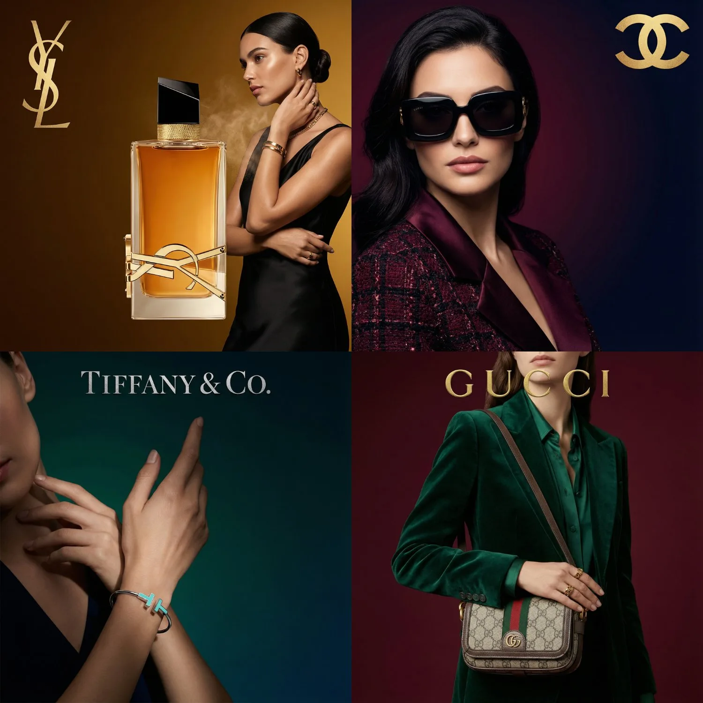

# AZIZ | AI 🇸🇦 — by @aziz4ai

[← Back to Community Examples](../../EXAMPLES.md) · Category: Poster Design · Model: `Nano Banana`

<a href="https://x.com/aziz4ai/status/2008592833406791789"></a>

Source: **[@aziz4ai on X](https://x.com/aziz4ai/status/2008592833406791789)** · Creator: [AZIZ | AI 🇸🇦](https://x.com/aziz4ai)

## Prompt

```text
[upload luxury product photo]
BRAND NAME: [Put the brand name here]

Create ONE luxury editorial poster. Keep the product EXACT and unchanged. Use the BRAND NAME to infer identity and place the REAL official logo (correct proportions) in the most brand-appropriate position with subtle print texture. Add a perfectly matched attractive model wearing the product naturally. Rich deep colors, HDR, premium studio lighting, clean background, strong negative space, ultra-sharp 8K. No extra text, no watermark.
```

## Try it

Paste the prompt into **[vinano.ai](https://vinano.ai?utm_source=github&utm_medium=readme&utm_campaign=awesome-image-video-prompts-updating&utm_content=x-page-try)** to generate your own version.

> The image and prompt belong to @aziz4ai ([original post](https://x.com/aziz4ai/status/2008592833406791789)) and are shown here with credit for reference. Creators can ask for changes or removal by opening an issue.
