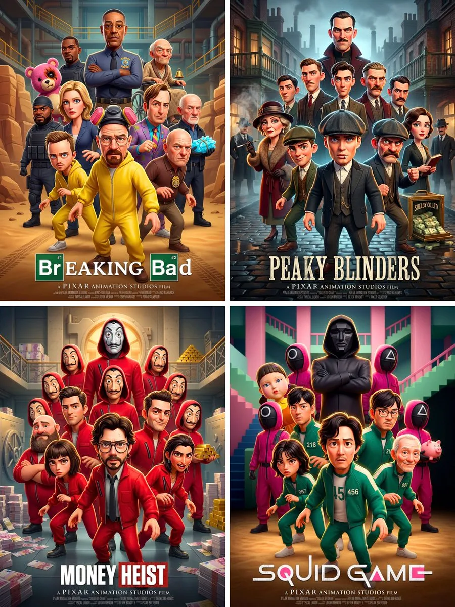

# TechieSA — by @TechieBySA

[← Back to Community Examples](../../EXAMPLES.md) · Category: Poster Design · Model: `Nano Banana`

<a href="https://x.com/TechieBySA/status/2037141030047215944"></a>

Source: **[@TechieBySA on X](https://x.com/TechieBySA/status/2037141030047215944)** · Creator: [TechieSA](https://x.com/TechieBySA)

## Prompt

```text
Pixar 3D CGI animated movie poster style, ensemble cast featuring the most iconic and recognizable characters from [MOVIE/SHOW], all rendered as Pixar-style 3D animated characters with exaggerated expressive faces, smooth stylized skin, big eyes, chunky proportions. Characters automatically selected as the most famous heroes and villains from [MOVIE/SHOW]. Dramatic layered composition: central hero front and center, others fanned behind in dynamic action poses. Background color automatically chosen to match the iconic tone and palette of [MOVIE/SHOW]. Bold title text at bottom: [MOVIE/SHOW] in the original film's iconic font style. Cinematic lighting, rim light on characters, deep shadows. 3:4 vertical aspect ratio. High detail, polished Pixar feature film aesthetic.
```

## Try it

Paste the prompt into **[vinano.ai](https://vinano.ai?utm_source=github&utm_medium=readme&utm_campaign=awesome-image-video-prompts-updating&utm_content=x-page-try)** to generate your own version.

> The image and prompt belong to @TechieBySA ([original post](https://x.com/TechieBySA/status/2037141030047215944)) and are shown here with credit for reference. Creators can ask for changes or removal by opening an issue.
