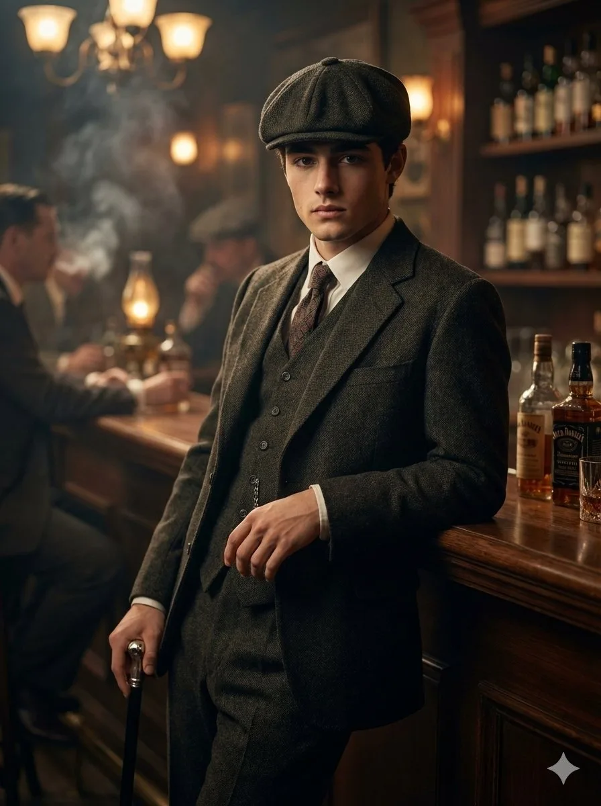

# Harboriis — by @harboriis

[← Back to Community Examples](../../EXAMPLES.md) · Category: Photography · Model: `Nano Banana`

<a href="https://x.com/harboriis/status/2008734714769899903"></a>

Source: **[@harboriis on X](https://x.com/harboriis/status/2008734714769899903)** · Creator: [Harboriis](https://x.com/harboriis)

## Prompt

```text
A hyper-realistic cinematic 3:4 vertical half-body portrait of a young man with the exact face from reference image, leaning casually against a 1920s smoky bar table, holding a vintage walking cane. He wears Peaky Blinders-inspired attire-tailored wool three-piece suit, waistcoat, tie, and flat cap. Head slightly down, eyes locked on camera with an intense, confident stare. Warm, ambient lighting casts moody shadows; blurred crowd and glowing whisky bottles in soft bokeh create depth. Shot with 85mm f/1.4 lens, 8K quality, highlighting fabric textures and facial expression.
```

## Try it

Paste the prompt into **[vinano.ai](https://vinano.ai?utm_source=github&utm_medium=readme&utm_campaign=awesome-image-video-prompts-updating&utm_content=x-page-try)** to generate your own version.

> The image and prompt belong to @harboriis ([original post](https://x.com/harboriis/status/2008734714769899903)) and are shown here with credit for reference. Creators can ask for changes or removal by opening an issue.
