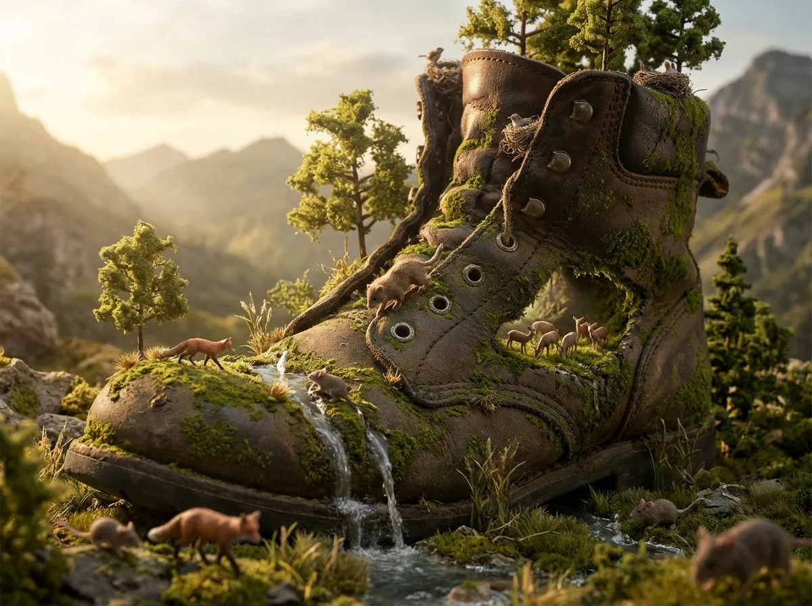

# Alexandra Aisling — by @AllaAisling

[← Back to Community Examples](../../EXAMPLES.md) · Category: Illustration & 3D · Model: `Nano Banana`

<a href="https://x.com/AllaAisling/status/2011819664536444937"></a>

Source: **[@AllaAisling on X](https://x.com/AllaAisling/status/2011819664536444937)** · Creator: [Alexandra Aisling](https://x.com/AllaAisling)

## Prompt

```text
A colossal [OBJECT] reimagined as a complete natural biome. Tiny [WILDLIFE] has evolved to inhabit every niche the object provides. Predators hunt across its surfaces, herbivores graze in its cavities, birds nest in its heights, insects swarm its crevices. Food chains have formed around the object's geometry. Migration patterns follow its contours. Seasonal changes affect different zones. The object's materials have weathered into naturalistic terrain while remaining recognizable. Documentary aesthetic, golden wildlife lighting, the manufactured as wilderness.
```

## Try it

Paste the prompt into **[vinano.ai](https://vinano.ai?utm_source=github&utm_medium=readme&utm_campaign=awesome-image-video-prompts-updating&utm_content=x-page-try)** to generate your own version.

> The image and prompt belong to @AllaAisling ([original post](https://x.com/AllaAisling/status/2011819664536444937)) and are shown here with credit for reference. Creators can ask for changes or removal by opening an issue.
