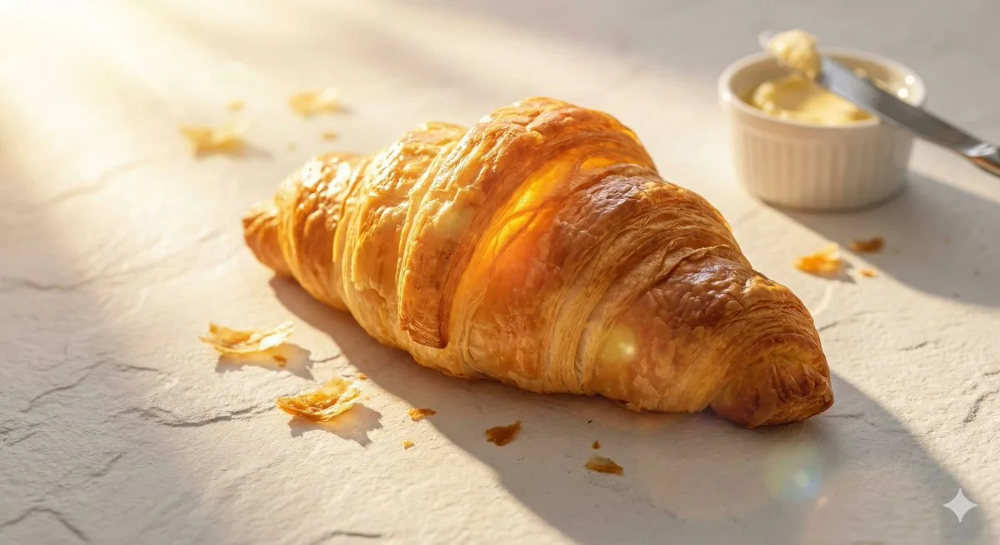

# Aleena Amir — by @aleenaamiir

[← Back to Examples from X](../../EXAMPLES.md) · Category: Food & Drink · Model: `Nano Banana`

<a href="https://x.com/aleenaamiir/status/2013251289254420955"></a>

Original post: **[@aleenaamiir on X](https://x.com/aleenaamiir/status/2013251289254420955)** · Creator: [Aleena Amir](https://x.com/aleenaamiir)

## Prompt

```text
“Luxury golden-hour styled hero shot of [FOOD] bathed in warm directional sunlight. Long soft shadows, glowing highlights, natural lens flares. Minimal white set with subtle texture. Editorial lifestyle food photography aesthetic, rich color depth, atmospheric warmth, ultra-realistic detail, premium ad quality, 8K resolution.”
```

## Try it

Paste the prompt into **[vinano.ai](https://vinano.ai?utm_source=github&utm_medium=readme&utm_campaign=awesome-image-video-prompts-updating&utm_content=x-page-try)** to generate your own version.

> The image and prompt belong to [@aleenaamiir](https://x.com/aleenaamiir) and are shown here with credit for reference. Creators can ask for changes or removal by opening an issue.
