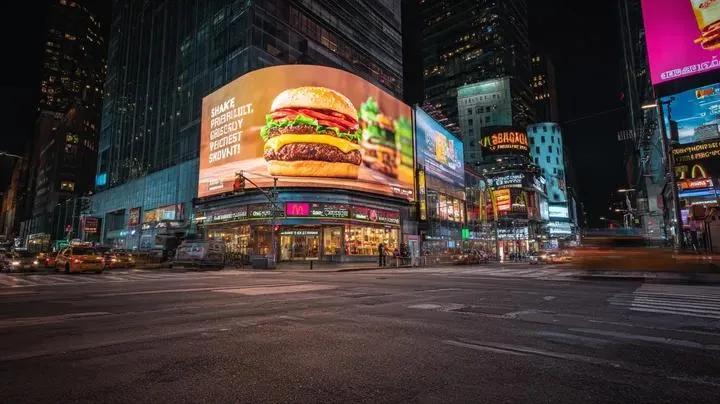

# 𝐌 — by @Strength04_X

[← Back to Examples from X](../../EXAMPLES.md) · Category: Photography · Model: `Nano Banana`

<a href="https://x.com/Strength04_X/status/2013552127705260441"></a>

Original post: **[@Strength04_X on X](https://x.com/Strength04_X/status/2013552127705260441)** · Creator: [𝐌](https://x.com/Strength04_X)

## Prompt

```text
Ultra-realistic cinematic night cityscape inspired by Times Square, New York. A wide-angle street-level view of a busy urban intersection at night with wet asphalt reflecting neon lights. Massive curved LED billboard on a corner building displaying a hyper-realistic gourmet burger advertisement, glowing vividly and dominating the scene. Surrounding skyscrapers covered with bright digital screens, brand signage, and colorful ads. Motion-blurred traffic trails from passing cars, subtle pedestrians near sidewalks, dramatic contrast between dark sky and illuminated buildings. Cyber-urban atmosphere, commercial advertising aesthetic, long-exposure photography look, sharp architectural details, realistic lighting and reflections, ultra-high resolution, 8K photorealism, cinematic depth, no text overlay.
```

## Try it

Paste the prompt into **[vinano.ai](https://vinano.ai?utm_source=github&utm_medium=readme&utm_campaign=awesome-image-video-prompts-updating&utm_content=x-page-try)** to generate your own version.

> The image and prompt belong to [@Strength04_X](https://x.com/Strength04_X) and are shown here with credit for reference. Creators can ask for changes or removal by opening an issue.
