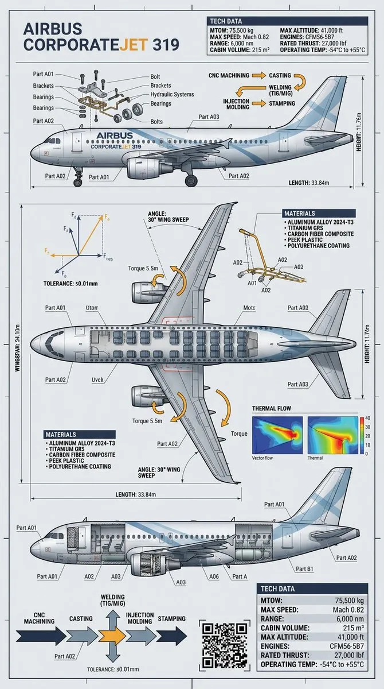

# 𝐌 — by @Strength04_X

[← Back to Examples from X](../../EXAMPLES.md) · Category: Product & Brand · Model: `Nano Banana`

<a href="https://x.com/Strength04_X/status/2021082486294675765"></a>

Original post: **[@Strength04_X on X](https://x.com/Strength04_X/status/2021082486294675765)** · Creator: [𝐌](https://x.com/Strength04_X)

## Prompt

```text
Industrial engineering-style infographic of an object (match exactly the object from the uploaded photo reference).
Ultra-precise technical rendering of the object placed at the center, with accurate proportions, textures, materials, and surface details identical to the reference photo.
Surround the object with industrial–grade technical elements:
• Blueprint-inspired dimension lines (length, width, height, radius, angle, tolerances).
• Cross-section cutaway view revealing internal components with engineering hatching patterns.
• Exploded-view assembly diagram showing bolts, brackets, joints, wiring, bearings, or internal mechanisms.
• Material specification blocks (steel type, plastics, alloys, coatings, finishes).
• Process flow arrows describing manufacturing steps (CNC, casting, welding, injection, stamping).
• Load & stress indicator graphics with arrows, vector force diagrams, thermal flow, or torque direction.
• Part numbering following industrial annotation style (Part A01, A02, etc).
• Tech data panels like: weight, volume, tolerances, rated load, pressure, RPM, operating temperature.
• QR-style data block or barcode element for extra industrial feel.
Design style:
• clean, structured, engineering-oriented layout
• color palette of steel grey, dark navy, orange/yellow safety accents
• background like a technical drafting sheet or industrial metal texture (subtle, not distracting)
• sharp sans-serif typeface using actual engineering annotation style
• shadows minimal, prioritizing clarity and precision
Overall vibe: serius, presisi, manufaktur-grade, seperti poster teknik pabrik atau katalog industrial tooling.
Aspect Ratio: 9:16
```

## Try it

Paste the prompt into **[vinano.ai](https://vinano.ai?utm_source=github&utm_medium=readme&utm_campaign=awesome-image-video-prompts-updating&utm_content=x-page-try)** to generate your own version.

> The image and prompt belong to [@Strength04_X](https://x.com/Strength04_X) and are shown here with credit for reference. Creators can ask for changes or removal by opening an issue.
