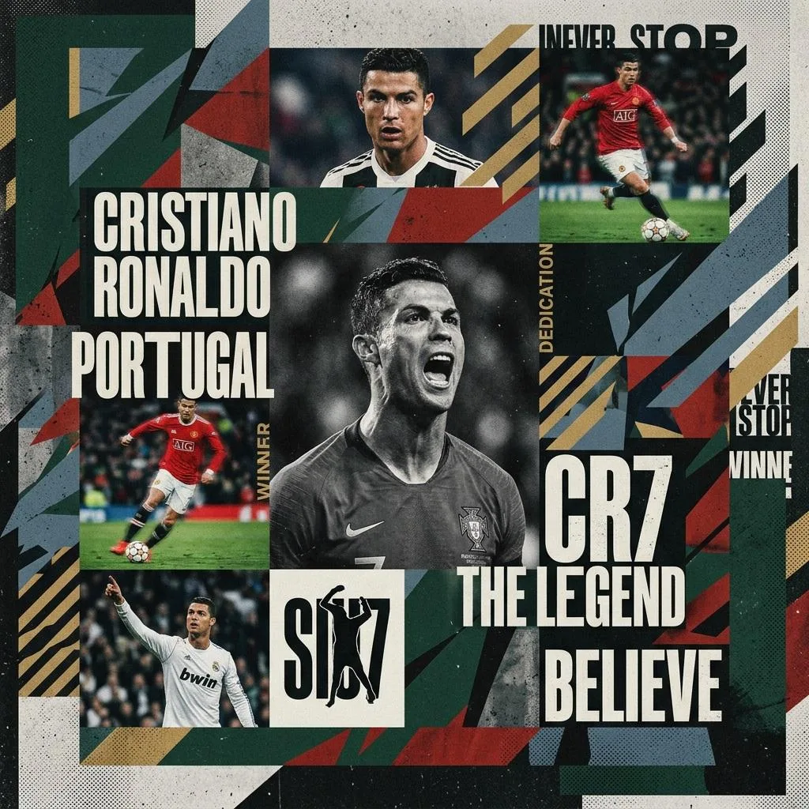

# Saul Goodman — by @Goodmanprotocol

[← Back to Community Examples](../../EXAMPLES.md) · Category: Poster Design · Model: `Nano Banana`

<a href="https://x.com/Goodmanprotocol/status/2045387100842070500"></a>

Source: **[@Goodmanprotocol on X](https://x.com/Goodmanprotocol/status/2045387100842070500)** · Creator: [Saul Goodman](https://x.com/Goodmanprotocol)

## Prompt

```text
Create a digital modern maximalism style sports collage of [TEAm Name] [Player name] visuals with grainy textures, abstract geometric shapes, dynamic grid layout, minimal background, contemporary editorial composition, inspired by [BRAND NAME ex Nike...] campaigns and modern sports graphic design, strong visual rhythm, bold and emotional atmosphere. Post-process film grain, and specially cinematic color-graded tones for serious intensity.
```

## Try it

Paste the prompt into **[vinano.ai](https://vinano.ai?utm_source=github&utm_medium=readme&utm_campaign=awesome-image-video-prompts-updating&utm_content=x-page-try)** to generate your own version.

> The image and prompt belong to @Goodmanprotocol ([original post](https://x.com/Goodmanprotocol/status/2045387100842070500)) and are shown here with credit for reference. Creators can ask for changes or removal by opening an issue.
