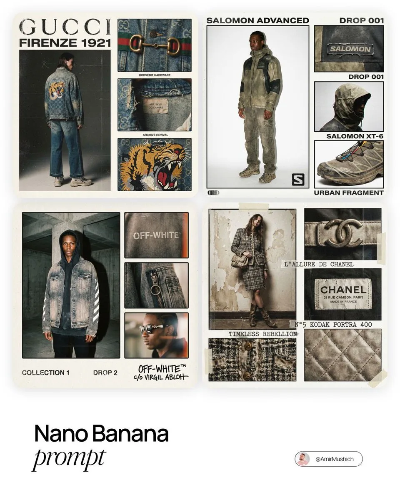

# AmirMušić — by @AmirMushich

[← Back to Examples from X](../../EXAMPLES.md) · Category: Product & Brand · Model: `Nano Banana`

<a href="https://x.com/AmirMushich/status/2022753970704286181"></a>

Original post: **[@AmirMushich on X](https://x.com/AmirMushich/status/2022753970704286181)** · Creator: [AmirMušić](https://x.com/AmirMushich)

## Prompt

```text
[BRAND NAME]. Act as a Creative Director and Brand Strategist.

PHASE 1: CONCEPT & COMPOSITION.

Create a multi-panel fashion lookbook collage (grid layout) on a clean off-white background. 

- Main Shot: A full-body editorial pose of a model wearing a signature [BRAND NAME] piece. 

- Detail Shots: 3-4 smaller rectangular frames showing macro crops of fabric, hardware, and stitching.

- Autonomously determine the garment type based on the brand's current hype items.

PHASE 2: VISUAL STYLE & TEXTURE.

"High-End Lo-fi" aesthetic. Intense film grain, analog noise, and scanline artifacts. Heavy, premium clothing textures: faded vintage washes, distressed edges, and high-quality "cracked" screen prints. Muted, moody color palette with brand-specific accents.

PHASE 3: DYNAMIC TYPOGRAPHY & LOGIC.

Autonomously analyze the [BRAND NAME] heritage and core identity to generate unique typography.

- Content: Instead of generic "Drop" labels, generate text based on the brand’s DNA: 

- Style: Match the font to the brand's era (e.g., brutalist sans-serif for modern labels, elegant serif for luxury house heritage). Integrate the [BRAND NAME] logo with a distressed, "Xerox-copied" texture.

TECH SPECS:

35mm film look (Kodak Portra 400), f/5.6 for raw sharpness, high ISO grain. High-contrast editorial flash, deep shadows. Octane render quality with an analog scan soul.
```

## Try it

Paste the prompt into **[vinano.ai](https://vinano.ai?utm_source=github&utm_medium=readme&utm_campaign=awesome-image-video-prompts-updating&utm_content=x-page-try)** to generate your own version.

> The image and prompt belong to [@AmirMushich](https://x.com/AmirMushich) and are shown here with credit for reference. Creators can ask for changes or removal by opening an issue.
