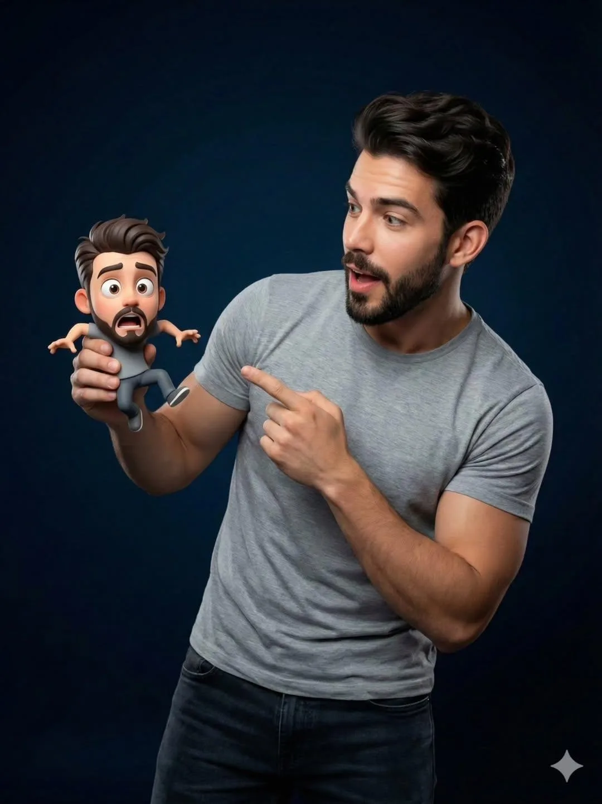

# Taaruk — by @Taaruk_

[← Back to Community Examples](../../EXAMPLES.md) · Category: Illustration & 3D · Model: `Nano Banana`

<a href="https://x.com/Taaruk_/status/2010269361190371754"></a>

Source: **[@Taaruk_ on X](https://x.com/Taaruk_/status/2010269361190371754)** · Creator: [Taaruk](https://x.com/Taaruk_)

## Prompt

```text
{
  "Objective": "Create a studio portrait blending a real human with a tiny Pixar-style 3D cartoon version of themselves in a playful, whimsical interaction",
  "PersonaDetails": {
    "PrimarySubject": {
      "Type": "Real human",
      "Wardrobe": "Casual grey sweater or t-shirt",
      "Expression": "Surprised and delighted",
      "Pose": "Holding a tiny character in one hand and pointing at it with the other",
      "Skin": "Photorealistic skin texture with natural detail"
    },
    "SecondarySubject": {
      "Type": "Tiny 3D cartoon version of the human",
      "Scale": "Miniature, resting in the human’s hand",
      "Style": "Pixar-style 3D character",
      "Proportions": "Exaggerated cute proportions with rounded features",
      "FacialFeatures": {
        "Eyes": "Large, expressive",
        "Expression": "Friendly, playful"
      },
      "Consistency": "Matching hairstyle and outfit of the real human"
    }
  },
  "Composition": {
    "Framing": "Medium close-up studio portrait",
    "InteractionFocus": "Clear visual relationship between human and miniature character",
    "DepthOfField": "Shallow depth of field",
    "Focus": "Ultra-sharp focus on both faces"
  },
  "LightingAndBackground": {
    "LightingStyle": "Soft cinematic studio lighting",
    "LightQuality": "Smooth highlights with gentle shadow falloff",
    "Background": "Dark blue gradient studio backdrop",
    "Separation": "Subtle rim light for subject-background separation"
  },
  "ArtDirection": {
    "StyleFusion": [
      "Photorealistic human portrait photography",
      "High-quality Pixar-style 3D character rendering"
    ],
    "Integration": "Seamless blending between real and 3D elements",
    "DetailLevel": "Ultra-detailed textures on skin, fabric, and 3D materials"
  },
  "MoodAndTone": {
    "Mood": "Whimsical, fun, lighthearted",
    "Energy": "Playful surprise and delight"
  },
  "PhotographyStyle": {
    "Genre": "Professional studio portrait photography",
    "CameraLook": "High-end cinematic realism",
    "ImageQuality": "High resolution, clean and sharp"
  },
  "NegativePrompt": [
    "uncanny valley",
    "cartoon human",
    "low-quality 3D",
    "harsh lighting",
    "oversaturated colors",
    "blurry focus",
    "flat composition"
  ],
  "ResponseFormat": {
    "Type": "Single image",
    "Orientation": "Portrait",
    "AspectRatio": "2:3"
  }
}
```

## Try it

Paste the prompt into **[vinano.ai](https://vinano.ai?utm_source=github&utm_medium=readme&utm_campaign=awesome-image-video-prompts-updating&utm_content=x-page-try)** to generate your own version.

> The image and prompt belong to @Taaruk_ ([original post](https://x.com/Taaruk_/status/2010269361190371754)) and are shown here with credit for reference. Creators can ask for changes or removal by opening an issue.
