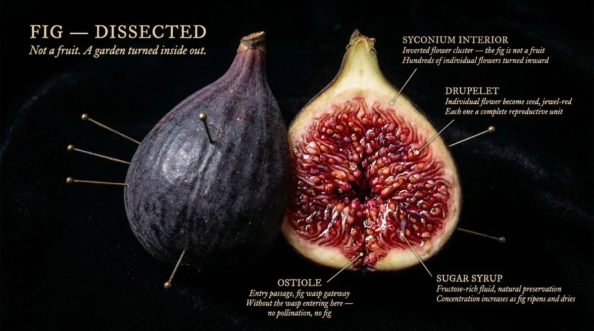

# Alexandra Aisling — by @AllaAisling

[← Back to Community Examples](../../EXAMPLES.md) · Category: Food & Drink · Model: `Nano Banana`

<a href="https://x.com/AllaAisling/status/2036472105223467305"></a>

Source: **[@AllaAisling on X](https://x.com/AllaAisling/status/2036472105223467305)** · Creator: [Alexandra Aisling](https://x.com/AllaAisling)

## Prompt

```text
[NATURAL OBJECT] dissected as if by a master naturalist who found it in the wild. Split and pinned open like a specimen, but lit as if Caravaggio worked for National Geographic.
Every internal structure glowing with its own material truth. Cross-section so sharp it feels violent. Interior so beautiful it feels sacred. The full object present, one half intact, one half opened to its core, every layer at the resolution of obsession.
Background: pure black velvet. The object floats in it like something precious and dangerous.
Labels pressed close, handwritten-weight serif, never floating: "[STRUCTURE]" / "[MATERIAL TRUTH]" / "[AGE OR SCALE]"
"[OBJECT] DISSECTED" title in warm ivory caps, upper left. "[One line that makes you lean closer]" italic beneath.
Mood: Audubon illustration meets Caravaggio meets the most beautiful science photograph ever taken. 4K, specimen lighting, extraordinary interior detail, nothing clinical, everything alive.
```

## Try it

Paste the prompt into **[vinano.ai](https://vinano.ai?utm_source=github&utm_medium=readme&utm_campaign=awesome-image-video-prompts-updating&utm_content=x-page-try)** to generate your own version.

> The image and prompt belong to @AllaAisling ([original post](https://x.com/AllaAisling/status/2036472105223467305)) and are shown here with credit for reference. Creators can ask for changes or removal by opening an issue.
