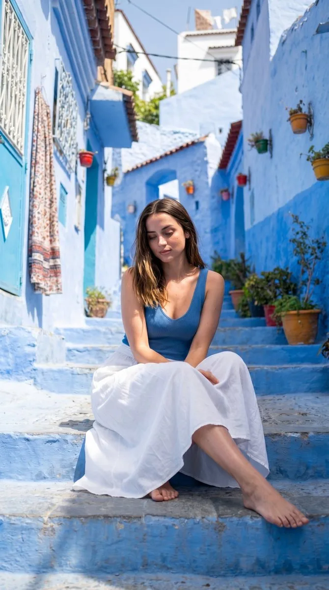

# glena Jenner — by @GlenaJenne

[← Back to Community Examples](../../EXAMPLES.md) · Category: Photography · Model: `Nano Banana`

<a href="https://x.com/GlenaJenne/status/2044511721205993480"></a>

Source: **[@GlenaJenne on X](https://x.com/GlenaJenne/status/2044511721205993480)** · Creator: [glena Jenner](https://x.com/GlenaJenne)

## Prompt

```text
{
  "scene": {
    "setting": "narrow outdoor alley with stepped pathway in a Mediterranean blue-painted town",
    "background": "vivid blue walls, stairs, and buildings with white accents, hanging fabric on wall, small windows, plants, and bright sky above",
    "lighting": "strong natural sunlight, high contrast with defined shadows, bright and saturated colors"
  },
  "subject": {
    "type": "female",
    "pose": "seated on steps with one leg bent and the other extended slightly forward, hands resting naturally by her sides",
    "expression": "soft relaxed expression with eyes slightly downward, calm and serene mood",
    "face": "Use uploaded reference image, keep identity exact, natural facial proportions, visible skin texture and realistic lighting",
    "hair": "Use uploaded reference image, keep identity exact, long wavy hair falling over shoulders with natural volume",
    "eyes": "Use uploaded reference image, keep identity exact, softly focused downward gaze",
    "skin": "natural skin tone with sunlit highlights and realistic texture",
    "body": "natural proportions maintained"
  },
  "clothing": {
    "outfit": "blue fitted sleeveless top paired with a long flowing white skirt",
    "footwear": "barefoot with both feet visible resting naturally on the blue steps",
    "accessories": "minimal jewelry, subtle necklace"
  },
  "environment_details": {
    "props": "textured painted steps, hanging patterned fabric, architectural details of alley",
    "textures": "rough painted walls, fabric folds in skirt, smooth skin highlights, stone steps"
  },
  "camera": {
    "angle": "slightly low front-facing angle centered on subject",
    "framing": "full body framing capturing entire seated pose and surrounding stairs",
    "focus": "sharp focus on subject with clear detailed background",
    "lens": "standard smartphone lens"
  },
  "style": {
    "realism": "ultra realistic photography",
    "color_tone": "highly saturated blues contrasted with neutral white and natural skin tones",
    "effects": "natural sunlight, no artificial filters",
    "details": "high detail textures, crisp shadows, realistic depth and perspective"
  }
}
```

## Try it

Paste the prompt into **[vinano.ai](https://vinano.ai?utm_source=github&utm_medium=readme&utm_campaign=awesome-image-video-prompts-updating&utm_content=x-page-try)** to generate your own version.

> The image and prompt belong to @GlenaJenne ([original post](https://x.com/GlenaJenne/status/2044511721205993480)) and are shown here with credit for reference. Creators can ask for changes or removal by opening an issue.
