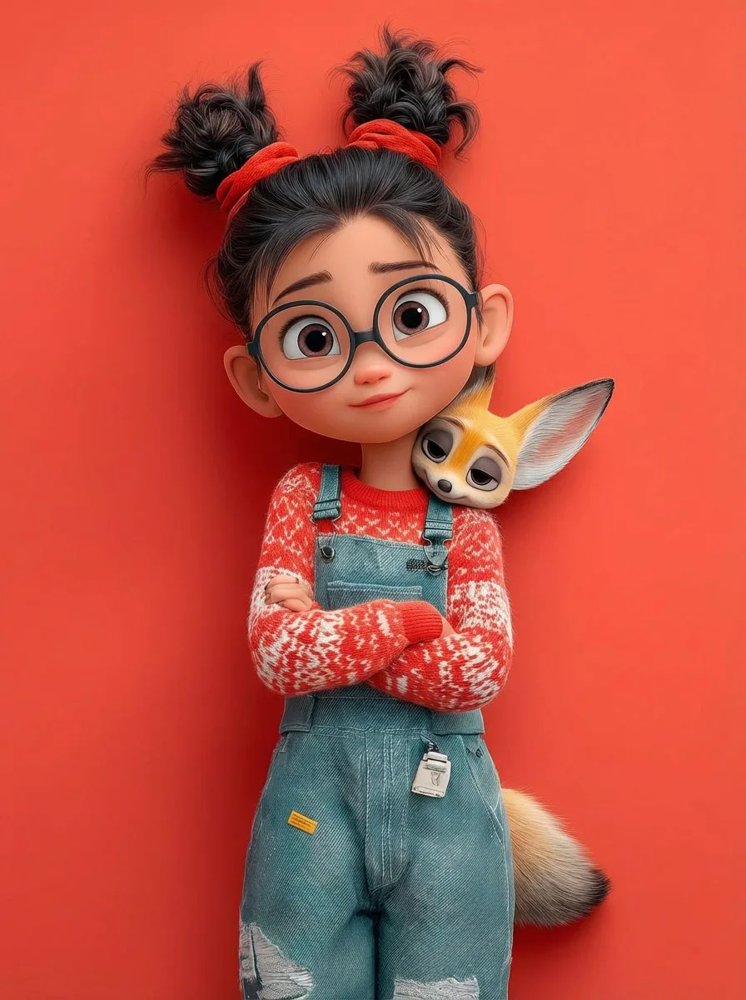

# Aijaz — by @iamsofiaijaz

[← Back to Examples from X](../../EXAMPLES.md) · Category: Illustration & 3D · Model: `Nano Banana`

<a href="https://x.com/iamsofiaijaz/status/2008359111650312559"></a>

Original post: **[@iamsofiaijaz on X](https://x.com/iamsofiaijaz/status/2008359111650312559)** · Creator: [Aijaz](https://x.com/iamsofiaijaz)

## Prompt

```text
A cute 3D Pixar-style character portrait of a little girl with big expressive eyes and round glasses, soft smooth skin, and slightly rosy cheeks. She has dark hair styled into two messy space buns tied with red scrunchies. She is wearing a cozy red knitted sweater with white winter patterns and blue denim overalls with small fabric details and light wear. Her arms are crossed casually. A small adorable fennec fox with huge ears and sleepy eyes is resting on her shoulder, leaning against her neck affectionately.
```

## Try it

Paste the prompt into **[vinano.ai](https://vinano.ai?utm_source=github&utm_medium=readme&utm_campaign=awesome-image-video-prompts-updating&utm_content=x-page-try)** to generate your own version.

> The image and prompt belong to [@iamsofiaijaz](https://x.com/iamsofiaijaz) and are shown here with credit for reference. Creators can ask for changes or removal by opening an issue.
