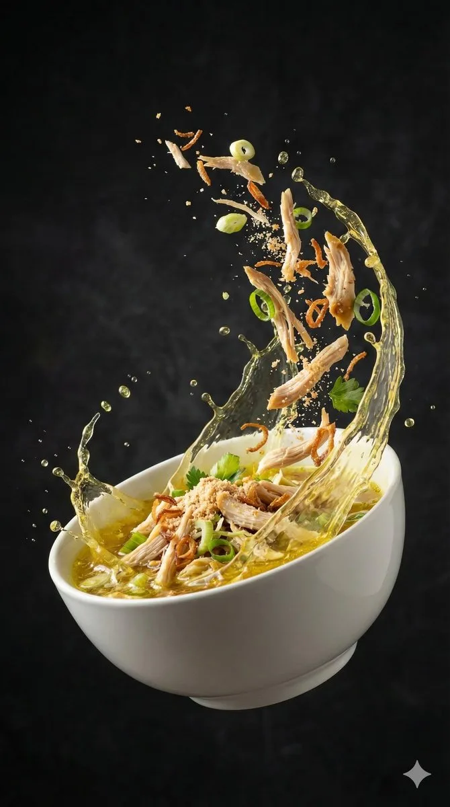

# K — by @ChillaiKalan__

[← Back to Examples from X](../../EXAMPLES.md) · Category: Food & Drink · Model: `Nano Banana`

<a href="https://x.com/ChillaiKalan__/status/2015383108452057585"></a>

Original post: **[@ChillaiKalan__ on X](https://x.com/ChillaiKalan__/status/2015383108452057585)** · Creator: [K](https://x.com/ChillaiKalan__)

## Prompt

```text
Use uploaded photo as absolute main reference. Preserve Seblak kuah identity, ingredients, textures, and proportions; do not add anything not present.
Intact ceramic bowl rises in a smooth swirling twirl motion; slight controlled tilt, stable anchor.
Destroy ONLY the FOOD: crackers/kerupuk tear and split revealing bubbly porous texture; toppings (as in reference) separate naturally; spicy broth stretches
```

## Try it

Paste the prompt into **[vinano.ai](https://vinano.ai?utm_source=github&utm_medium=readme&utm_campaign=awesome-image-video-prompts-updating&utm_content=x-page-try)** to generate your own version.

> The image and prompt belong to [@ChillaiKalan__](https://x.com/ChillaiKalan__) and are shown here with credit for reference. Creators can ask for changes or removal by opening an issue.
