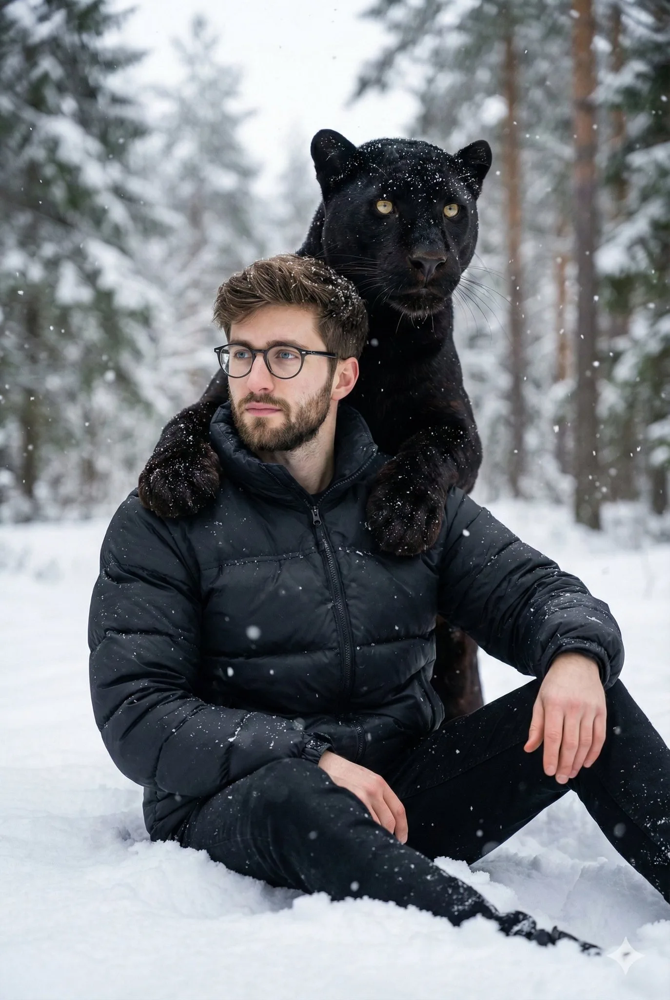

# Duet | AI — by @Sheldon056

[← Back to Community Examples](../../EXAMPLES.md) · Category: Photography · Model: `Nano Banana`

<a href="https://x.com/Sheldon056/status/2008374617979973865"></a>

Source: **[@Sheldon056 on X](https://x.com/Sheldon056/status/2008374617979973865)** · Creator: [Duet | AI](https://x.com/Sheldon056)

## Prompt

```text
A hyper-realistic 8k medium shot, captured with a standard lens (e.g., 85mm) at a slightly low angle, frames a man seated in deep snow within a snowy forest. The man, with uploaded face as reference, wears a highly detailed black puffer jacket and black pants, looking calmly towards the left side of the frame. Directly behind him, a majestic black panther stands, its large front paws gently resting on his shoulders, creating a surreal yet intimate spatial relationship. The panther's head is positioned just above and slightly to the right of the man's head, its piercing yellow eyes looking forward. The scene is bathed in soft, natural daylight, typical of an overcast winter day, providing cinematic lighting with subtle shadows and highlighting the highly detailed texture of the panther's sleek fur and the man's quilted jacket. Volumetric lighting is evident through the abundant falling snow, which dots the subjects and the environment. The background features a softly blurred snowy forest, emphasizing the central figures and their unique interaction.
```

## Try it

Paste the prompt into **[vinano.ai](https://vinano.ai?utm_source=github&utm_medium=readme&utm_campaign=awesome-image-video-prompts-updating&utm_content=x-page-try)** to generate your own version.

> The image and prompt belong to @Sheldon056 ([original post](https://x.com/Sheldon056/status/2008374617979973865)) and are shown here with credit for reference. Creators can ask for changes or removal by opening an issue.
