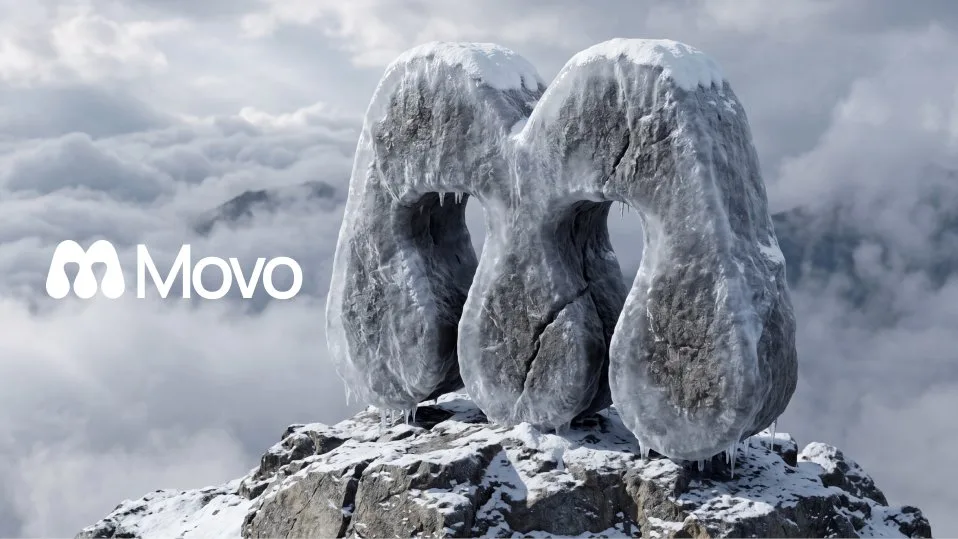

# Zazzy — by @zazzygfx

[← Back to Examples from X](../../EXAMPLES.md) · Category: Product & Brand · Model: `Nano Banana`

<a href="https://x.com/zazzygfx/status/2044465748714594617"></a>

Original post: **[@zazzygfx on X](https://x.com/zazzygfx/status/2044465748714594617)** · Creator: [Zazzy](https://x.com/zazzygfx)

## Prompt

```text
A hyper-realistic 3D render of a flat logo sculpted as a massive, frosted stone monument standing upright on the jagged peak of a rocky mountain summit.

The logo retains its exact silhouette and proportions but is fully translated into thick, solid carved rock encased in a layer of translucent frost and ice. Each element and shape of the logo is extruded with significant depth and volume, giving it a bold, chunky sculptural mass.

 The surface texture is rough, dark basalt or granite stone, partially obscured by a crystalline frost coating, with deep natural cracks, chipped edges, and fine granular detail across every face. The outer boundary of the logo forms the shell of the sculpture, with negative spaces between design elements carved out as open voids cutting through the rock.
The sculpture sits planted into the top of a rugged mountain peak, partially buried at its base, surrounded by cracked grey rock. A thick, textured layer of white snow and rime ice rests on the top flat surfaces of the logo forms and collects in the crevices and carved edges. Small icicles hang from the lower overhanging curves and edges, catching cold light. The entire structure has a subtle, semi-translucent frozen sheen, softening the harshness of the stone beneath.
The sky behind is filled with a dramatic, dense sea of clouds rolling over distant mountain peaks, creating a misty, ethereal, and cold atmosphere. Soft, diffused light filters through the cloud layer, creating a stark contrast against the dark, frosted stone sculpture. Lighting is soft natural daylight from slightly above and to the left, casting realistic shadows beneath the logo elements and across the rocky peak below. Ambient occlusion deepens the carved negative spaces between the design forms.

Camera angle is slightly low, looking up at the sculpture from a three-quarter front perspective, emphasizing the scale and monumentality of the logo form, mirroring the heroic composition of a landmark monument.

Rendering style: photorealistic, cinematic, ultra-detailed, physically based rendering, no text, no additional elements only the logo as a frosted stone sculpture on a cloud-covered mountain peak.
```

## Try it

Paste the prompt into **[vinano.ai](https://vinano.ai?utm_source=github&utm_medium=readme&utm_campaign=awesome-image-video-prompts-updating&utm_content=x-page-try)** to generate your own version.

> The image and prompt belong to [@zazzygfx](https://x.com/zazzygfx) and are shown here with credit for reference. Creators can ask for changes or removal by opening an issue.
