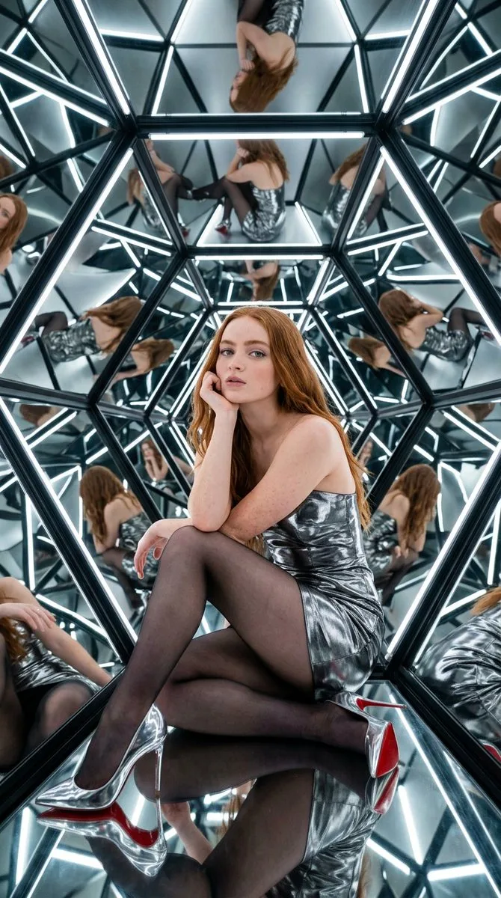

# ANKIT PATEL 🇮🇳 | AI — by @Ankit_patel211

[← Back to Examples from X](../../EXAMPLES.md) · Category: Photography · Model: `Nano Banana`

<a href="https://x.com/Ankit_patel211/status/2031334187689718167"></a>

Original post: **[@Ankit_patel211 on X](https://x.com/Ankit_patel211/status/2031334187689718167)** · Creator: [ANKIT PATEL 🇮🇳 | AI](https://x.com/Ankit_patel211)

## Prompt

```text
[
  {
    "id": "subject",
    "type": "person",
    "description": "Madelyn Cline with long blonde hair, looking at the camera.",
    "pose": "She is walking forward through the mirrored structure mid-step, one hand lightly brushing the metal framework while the other adjusts her hair as she glances toward the camera.",
    "clothing": {
      "dress": {
        "color": "deep violet",
        "material": "patent leather",
        "style": "strapless mini-dress"
      },
      "legwear": {
        "color": "black",
        "type": "sheer pantyhose"
      },
      "footwear": {
        "color": "Violet",
        "material": "patent leather",
        "style": "Louboutin So Kate with red sole"
      }
    }
  },
  {
    "id": "environment",
    "type": "room",
    "description": "A geometrically designed mirrored room with a fractured, kaleidoscopic effect.",
    "elements": [
      {
        "type": "mirrors",
        "description": "Multiple angled mirror panels reflecting the subject and the room structure."
      },
      {
        "type": "structure",
        "description": "Black metal framework holding the mirror panels."
      }
    ],
    "lighting": "Bright, high-contrast light from LED strips within the structure, creating sharp highlights and reflections, high-quality, cinematic, Ultra-realistic photo and lighting, high quality photo, depth of field, no Ai or cgi look, 8k resolution."
  }
]
```

## Try it

Paste the prompt into **[vinano.ai](https://vinano.ai?utm_source=github&utm_medium=readme&utm_campaign=awesome-image-video-prompts-updating&utm_content=x-page-try)** to generate your own version.

> The image and prompt belong to [@Ankit_patel211](https://x.com/Ankit_patel211) and are shown here with credit for reference. Creators can ask for changes or removal by opening an issue.
