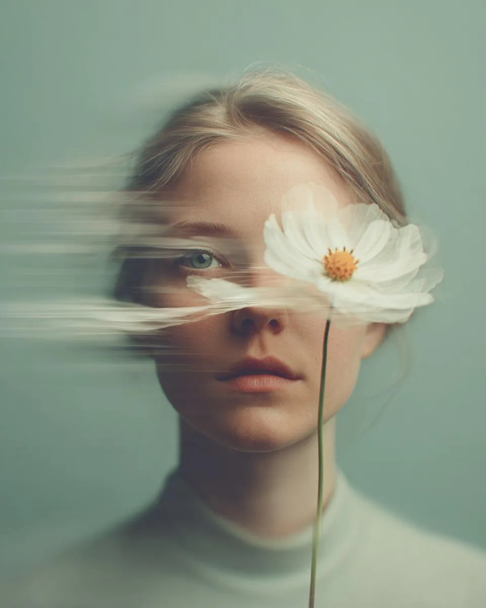

# Taaruk — by @Taaruk_

[← Back to Examples from X](../../EXAMPLES.md) · Category: Photography · Model: `Nano Banana`

<a href="https://x.com/Taaruk_/status/2020780086363054275"></a>

Original post: **[@Taaruk_ on X](https://x.com/Taaruk_/status/2020780086363054275)** · Creator: [Taaruk](https://x.com/Taaruk_)

## Prompt

```text
Ultra-realistic fine-art portrait of a young woman with soft natural features, minimal makeup, and calm introspective expression. Pastel muted background in sage green tones. Delicate flowers drifting across the frame in the foreground, creating intentional motion blur and soft streaks of light. Subtle double exposure and slow-shutter motion effects across the face, dreamy and poetic atmosphere. Gentle diffused lighting with smooth highlights on skin, natural texture preserved. Elegant minimalist composition, emotional and serene mood, editorial fine-art photography style, shallow depth of field, cinematic softness, painterly realism, ultra-high resolution, 8K quality.
```

## Try it

Paste the prompt into **[vinano.ai](https://vinano.ai?utm_source=github&utm_medium=readme&utm_campaign=awesome-image-video-prompts-updating&utm_content=x-page-try)** to generate your own version.

> The image and prompt belong to [@Taaruk_](https://x.com/Taaruk_) and are shown here with credit for reference. Creators can ask for changes or removal by opening an issue.
