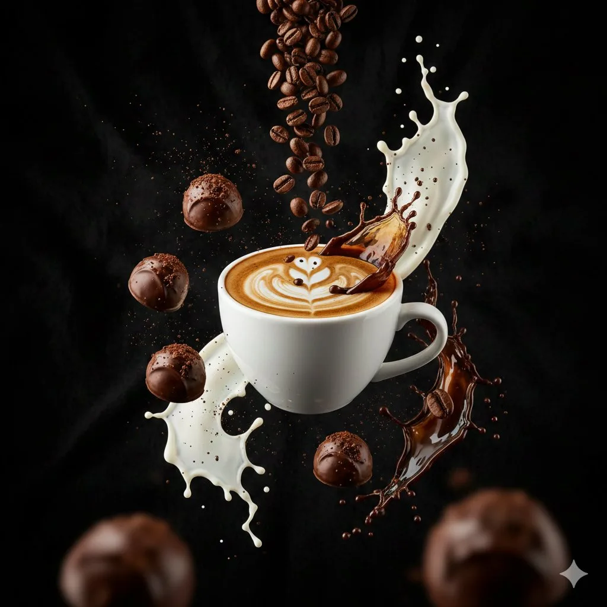

# Sharon Riley — by @Just_sharon7

[← Back to Examples from X](../../EXAMPLES.md) · Category: Food & Drink · Model: `Nano Banana`

<a href="https://x.com/Just_sharon7/status/2012291576119312710"></a>

Original post: **[@Just_sharon7 on X](https://x.com/Just_sharon7/status/2012291576119312710)** · Creator: [Sharon Riley](https://x.com/Just_sharon7)

## Prompt

```text
{
  "composition": {
    "orientation": "vertical",
    "style": "ultra-cinematic",
    "scene_type": "mid-air suspended elements",
    "depth_of_field": "cinematic shallow depth"
  },
  "subject": {
    "main_elements": [
      "cascading roasted coffee beans",
      "floating chocolate bonbons",
      "mid-air coffee cup with swirling latte art",
      "splashes of milk frozen in motion",
      "splashes of espresso frozen in motion",
      "fine coffee grounds dusting through the air"
    ],
    "motion_state": "frozen action splash photography"
  },
  "color_palette": {
    "primary_colors": [
      "rich coffee brown",
      "warm cream",
      "espresso black"
    ],
    "background": "deep velvety black"
  },
  "lighting": {
    "type": "dramatic high-contrast studio lighting",
    "highlights": "glossy reflections on liquids",
    "shadows": "deep cinematic shadows"
  },
  "texture_detail": {
    "liquids": [
      "glossy milk splashes",
      "glossy espresso splashes",
      "crema bubbles with micro-detail"
    ],
    "solids": [
      "matte roasted coffee beans",
      "smooth chocolate bonbon surfaces",
      "fine granular coffee grounds"
    ]
  },
  "photography_style": {
    "genre": "premium café advertising",
    "aesthetic": "editorial splash photography",
    "clarity": "crisp ultra-detailed"
  },
  "camera": {
    "camera_model": "Nikon D850 (virtual)",
    "lens": "105mm macro",
    "aperture": "f/4.0",
    "focus": "sharp subject focus with background falloff"
  },
  "render_quality": {
    "detail_level": "hyper-detailed",
    "realism": "photorealistic",
    "finish": "high-end commercial output"
  }
}
```

## Try it

Paste the prompt into **[vinano.ai](https://vinano.ai?utm_source=github&utm_medium=readme&utm_campaign=awesome-image-video-prompts-updating&utm_content=x-page-try)** to generate your own version.

> The image and prompt belong to [@Just_sharon7](https://x.com/Just_sharon7) and are shown here with credit for reference. Creators can ask for changes or removal by opening an issue.
