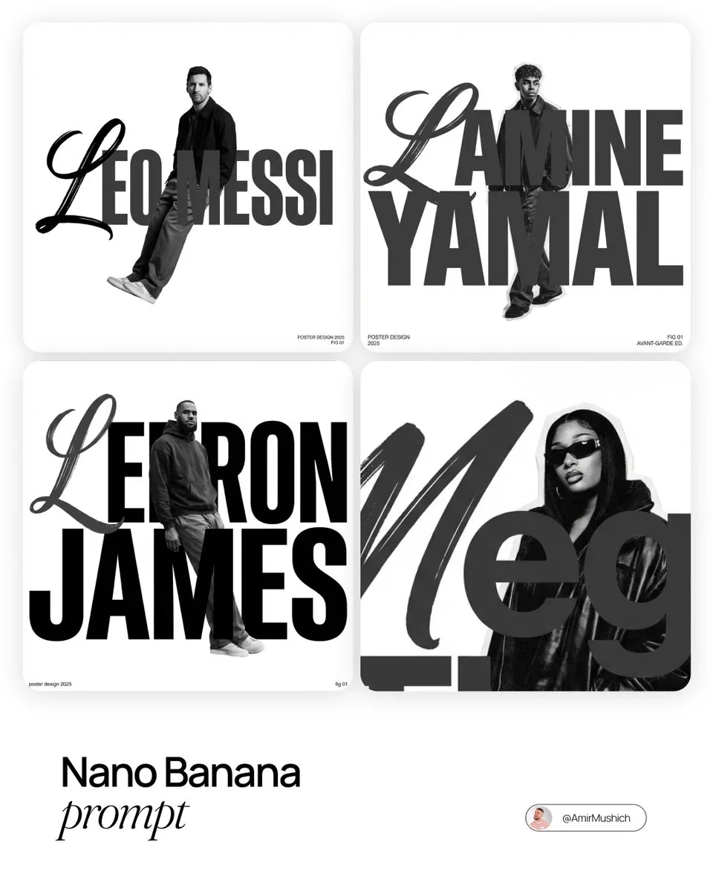

# AmirMušić — by @AmirMushich

[← Back to Examples from X](../../EXAMPLES.md) · Category: Poster Design · Model: `Nano Banana`

<a href="https://x.com/AmirMushich/status/2011170447434649774"></a>

Original post: **[@AmirMushich on X](https://x.com/AmirMushich/status/2011170447434649774)** · Creator: [AmirMušić](https://x.com/AmirMushich)

## Prompt

```text
[PERSON NAME]. Act as a graphic designer creating a minimalist, avant-garde streetwear poster.
COMPOSITION (THE FUSION):
The image is a creative fusion of a massive typographic name and a monochrome portrait of [PERSON NAME].
The Subject: A high-contrast, black-and-white full-body or 3/4 cut-out photograph of [PERSON NAME]. The subject stands centrally, looking cool and detached.
The Typography: The person's name is written horizontally across the entire width of the image. The text interacts with the body: the person stands through the letters, creating a "woven" depth effect (some limbs in front of text, some behind), or the portrait creates a silhouette mask for the text.
TYPOGRAPHY STYLE (MIXED SCRIPTS):
Mimic the specific "Street Editorial" font pairing:
The First Letter: The initial letter of the name is rendered in a large, sweeping, expressive Calligraphic Script or Brush font (dynamic and loose).
The Rest of the Name: The remaining letters are rendered in an Ultra-Heavy, Geometric Sans-Serif font (like Impact or Helvetica Black).
Color: The text is solid Dark Grey or Black.
AESTHETICS & ATMOSPHERE:
Palette: Strictly Monochrome (Black, White, and Greyscale).
Background: Pure, vast White Minimalist background. Extensive negative space.
Vibe: Raw, "Zine" aesthetic, cut-and-paste collage feel, high-fashion streetwear poster.
LAYOUT DETAILS:
Add very small, microscopic functional text in the extreme corners (e.g., "poster design", "2025", "fig 01") to enhance the Swiss Design poster feel.
```

## Try it

Paste the prompt into **[vinano.ai](https://vinano.ai?utm_source=github&utm_medium=readme&utm_campaign=awesome-image-video-prompts-updating&utm_content=x-page-try)** to generate your own version.

> The image and prompt belong to [@AmirMushich](https://x.com/AmirMushich) and are shown here with credit for reference. Creators can ask for changes or removal by opening an issue.
