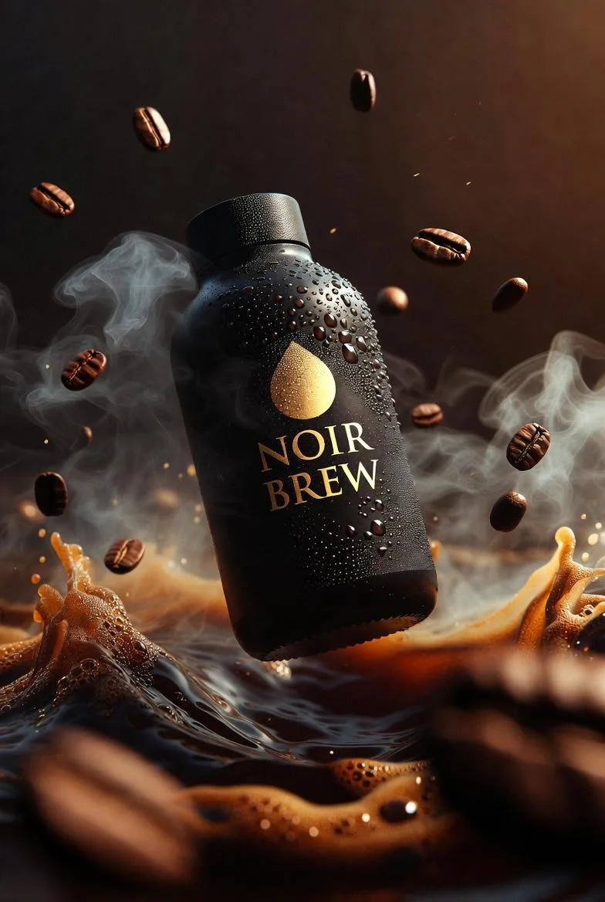

# Oogie — by @oggii_0

[← Back to Examples from X](../../EXAMPLES.md) · Category: Product & Brand · Model: `Nano Banana`

<a href="https://x.com/oggii_0/status/2012108162447585523"></a>

Original post: **[@oggii_0 on X](https://x.com/oggii_0/status/2012108162447585523)** · Creator: [Oogie](https://x.com/oggii_0)

## Prompt

```text
Ultra-cinematic premium coffee bottle labeled “NOIR BREW”, matte black glass with gold typography, floating upright amid swirling espresso waves and roasted coffee beans. Steam and mist curling around the bottle, dramatic low-key lighting with warm highlights and deep shadows, rich brown color grading, macro condensation details, cinematic depth of field, photorealistic, 8K, luxury branding aesthetic.
```

## Try it

Paste the prompt into **[vinano.ai](https://vinano.ai?utm_source=github&utm_medium=readme&utm_campaign=awesome-image-video-prompts-updating&utm_content=x-page-try)** to generate your own version.

> The image and prompt belong to [@oggii_0](https://x.com/oggii_0) and are shown here with credit for reference. Creators can ask for changes or removal by opening an issue.
