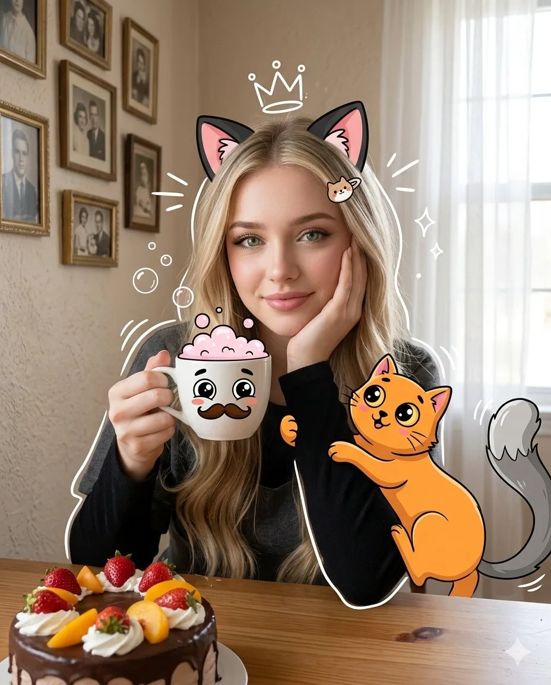

# Sharon Riley — by @Just_sharon7

[← Back to Examples from X](../../EXAMPLES.md) · Category: Illustration & 3D · Model: `Nano Banana`

<a href="https://x.com/Just_sharon7/status/2029006238101680432"></a>

Original post: **[@Just_sharon7 on X](https://x.com/Just_sharon7/status/2029006238101680432)** · Creator: [Sharon Riley](https://x.com/Just_sharon7)

## Prompt

```text
{
  "title": "Whimsical Cozy Portrait",
  "input_image": "[UPLOAD YOUR IMAGE]",
  "description": "Transform the uploaded image into a 64K DSLR-quality ultra-hyperrealistic cozy, whimsical mixed-media portrait combining realistic photography with playful cartoon illustrations.",
  "subject": {
    "person": {
      "appearance": {
        "hair": "blonde, loosely tied with soft strands framing the face",
        "eyes": "light green",
        "makeup": "natural",
        "top": "dark grey layered over black long-sleeve shirt",
        "expression": "resting cheek gently on one hand, dreamy and slightly tired",
        "accessories": [
          "black-and-pink cat ears",
          "small cute hair clip"
        ]
      },
      "pose": "sitting at a wooden table, holding a white ceramic mug in one hand"
    },
    "animated_elements": [
      {
        "type": "cartoon_cat",
        "color": "bright orange",
        "expression": "excited, curious",
        "action": "climbing up her arm",
        "features": "exaggerated big eyes, expressive paws"
      },
      {
        "type": "cartoon_tail",
        "color": "grey",
        "position": "right side, partially out of frame"
      }
    ]
  },
  "props": {
    "mug": {
      "color": "white",
      "illustration": "cute cartoon face with big expressive eyes and small mustache",
      "drink": "pink foam bubbles rising from the top"
    },
    "dessert": {
      "type": "chocolate cake",
      "toppings": ["whipped cream", "sliced strawberries", "peach slice"]
    }
  },
  "environment": {
    "room": {
      "walls": "beige textured",
      "lighting": "soft daylight streaming through window with sheer white curtains",
      "decor": "vintage framed photographs in casual gallery arrangement",
      "atmosphere": "warm, cozy, intimate"
    }
  },
  "illustration_effects": {
    "style": [
      "hand-drawn cartoon overlays",
      "white doodle-style accents: bubbles, playful lines, sparkles, hand-drawn crown",
      "soft white illustrated outlines around woman and objects"
    ]
  },
  "composition": {
    "aspect_ratio": ["1:1", "4:5 vertical"],
    "depth_of_field": "shallow",
    "mood": ["cozy", "cute", "whimsical", "soft", "playful", "warm"]
  },
  "rendering": {
    "technique": ["Octane render", "Ultra-hyperrealistic", "Unreal Engine 5"],
    "details": "ultra-detailed, high-resolution, soft natural lighting, warm tones, Instagram-worthy",
    "texture_contrast": "realistic textures (skin, fabric, wood, wall) vs smooth vector-style illustrations"
  }
}
```

## Try it

Paste the prompt into **[vinano.ai](https://vinano.ai?utm_source=github&utm_medium=readme&utm_campaign=awesome-image-video-prompts-updating&utm_content=x-page-try)** to generate your own version.

> The image and prompt belong to [@Just_sharon7](https://x.com/Just_sharon7) and are shown here with credit for reference. Creators can ask for changes or removal by opening an issue.
