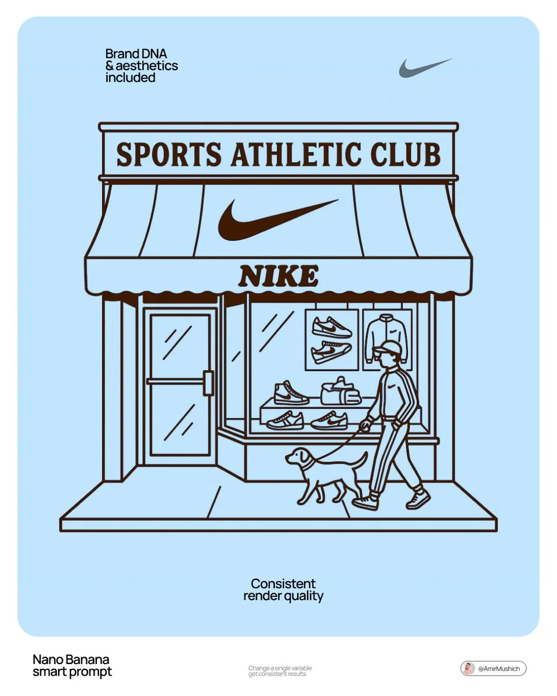

# AmirMušić — by @AmirMushich

[← Back to Examples from X](../../EXAMPLES.md) · Category: Product & Brand · Model: `Nano Banana`

<a href="https://x.com/AmirMushich/status/2024533642555371878"></a>

Original post: **[@AmirMushich on X](https://x.com/AmirMushich/status/2024533642555371878)** · Creator: [AmirMušić](https://x.com/AmirMushich)

## Prompt

```text
[BRAND NAME] | [SUBJECT_TOGGLE]. Act as a Lead Graphic Designer.

PHASE 1: ARCHITECTURAL SETTING.

Create a minimalist 2D vector illustration of a vintage-style storefront representing [BRAND NAME]. 

- Autonomously design the facade (Modernist, Industrial, or Classic) to match the brand's heritage.

PHASE 2: SUBJECT LOGIC (TOGGLE SYSTEM).

- If [SUBJECT_TOGGLE] is "OFF": Show only the empty storefront.

- If [SUBJECT_TOGGLE] is "ON": Autonomously add 1-2 characters or a pet that fits the brand's lifestyle.

PHASE 3: DYNAMIC TYPOGRAPHY (CORRECTED).

- Header: Autonomously generate a high-status "Club" or "Community" title based on the nature of [BRAND NAME]. * Examples: For Starbucks — "Coffee Roasters Society"; for Nike — "Elite Runners Club"; for Apple — "Digital Creators Guild". 

- Branding: Place the [BRAND NAME] logo clearly on the storefront awning.

- Contextual Info: Below the awning, add "EST. [REAL FOUNDING YEAR]" and "[REAL ORIGIN CITY]".

PHASE 4: VISUAL STYLE.

- Two-tone palette: [BRAND SIGNATURE COLOR] on a pure white background.

- Style: 1950s-60s Retro Line Art. No gradients, no shadows.

TECH SPECS:

Flat 2D vector, 8k resolution, monochrome aesthetic, centered composition.
```

## Try it

Paste the prompt into **[vinano.ai](https://vinano.ai?utm_source=github&utm_medium=readme&utm_campaign=awesome-image-video-prompts-updating&utm_content=x-page-try)** to generate your own version.

> The image and prompt belong to [@AmirMushich](https://x.com/AmirMushich) and are shown here with credit for reference. Creators can ask for changes or removal by opening an issue.
