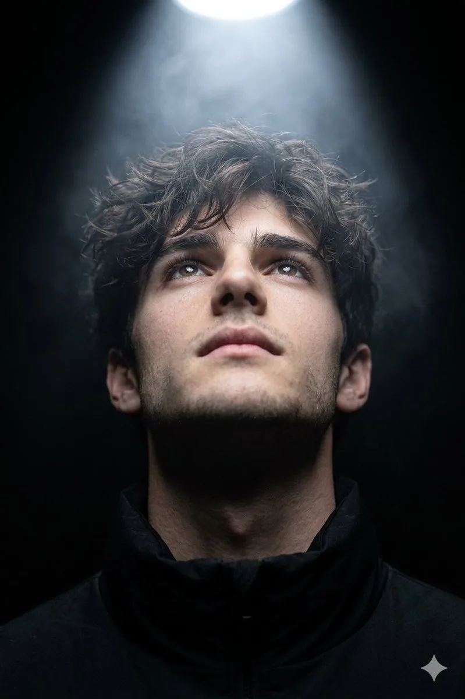

# Harboriis — by @harboriis

[← Back to Community Examples](../../EXAMPLES.md) · Category: Photography · Model: `Nano Banana`

<a href="https://x.com/harboriis/status/2031362125055369376"></a>

Source: **[@harboriis on X](https://x.com/harboriis/status/2031362125055369376)** · Creator: [Harboriis](https://x.com/harboriis)

## Prompt

```text
A hyper-realistic cinematic close-up portrait (use uploaded face as reference).
The subject looks upward with chin slightly raised and eyes half-open, as if drawn to a light above. A cool white overhead spotlight creates dramatic top-down lighting, sculpting the face while the background stays black. Soft volumetric mist forms a subtile light beam. Wearing a matte black high-collar jacket.
Shot on an 85mm lens with shallow depth of field, high contrast, and a spiritual, transcendental mood. Portrait Mode.
```

## Try it

Paste the prompt into **[vinano.ai](https://vinano.ai?utm_source=github&utm_medium=readme&utm_campaign=awesome-image-video-prompts-updating&utm_content=x-page-try)** to generate your own version.

> The image and prompt belong to @harboriis ([original post](https://x.com/harboriis/status/2031362125055369376)) and are shown here with credit for reference. Creators can ask for changes or removal by opening an issue.
