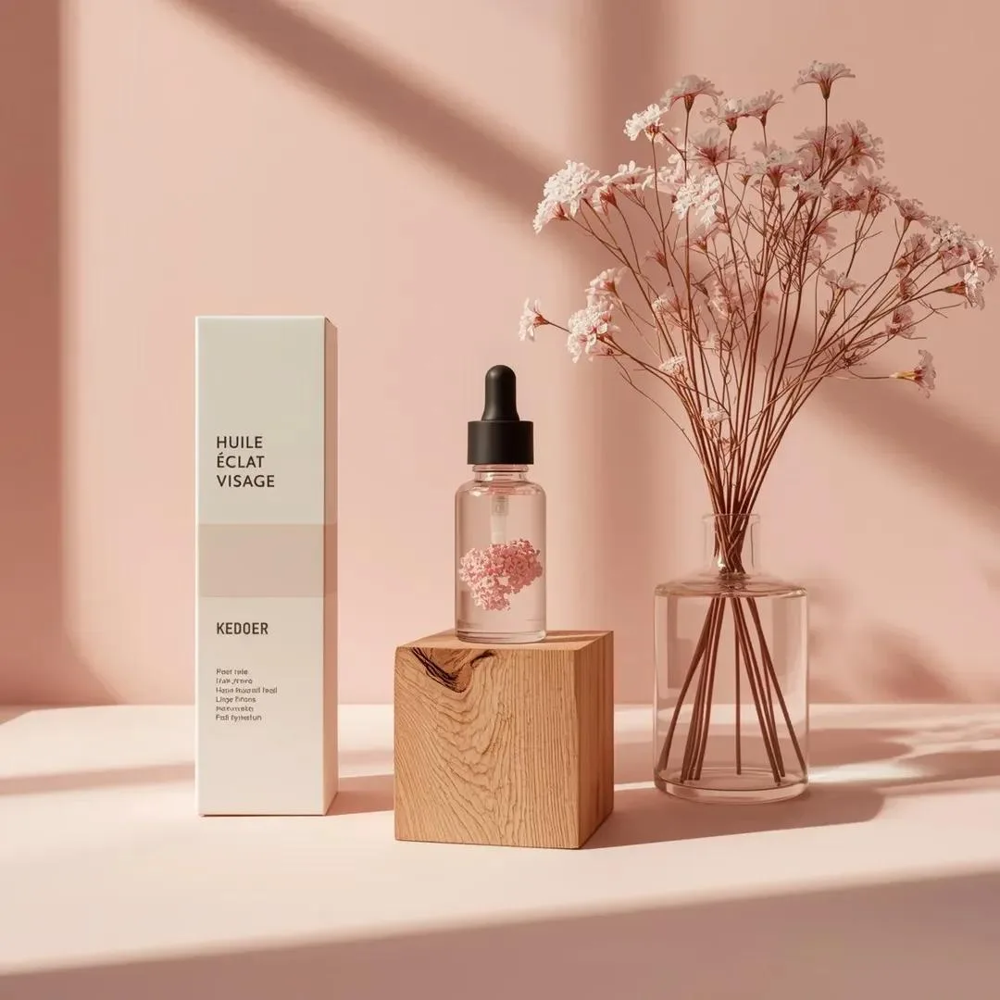

# Oogie — by @oggii_0

[← Back to Community Examples](../../EXAMPLES.md) · Category: Product & Brand · Model: `Nano Banana`

<a href="https://x.com/oggii_0/status/2016131317759672439"></a>

Source: **[@oggii_0 on X](https://x.com/oggii_0/status/2016131317759672439)** · Creator: [Oogie](https://x.com/oggii_0)

## Prompt

```text
Ultra-realistic minimalist studio product photography of a small transparent glass facial oil dropper bottle with a black rubber pipette cap, containing pale pink serum with dried pink floral elements suspended inside, placed centered on top of a natural raw wooden cube block with visible grain and split texture. To the left of the cube stands a tall matte white rectangular skincare box with minimal black typography reading “HUILE ÉCLAT VISAGE,” clean modern branding, and subtle logo near the bottom. To the right of the cube is a clear cylindrical glass vase filled with water and thin stems of dried pink gypsophila flowers extending upward and outward. The entire composition is arranged on a smooth matte pastel pink surface with a matching soft pink seamless studio background. Strong directional soft light comes from the left side, casting long, soft-edged realistic shadows of the flowers and objects onto the pink background. Lighting is natural-style, -det diffused, and warm, creating gentle highlights on the glass, subtle reflections on the serum bottle, and soft texture on the wooden block. Camera angle is straight-on at tabletop height, medium framing, all main objects in sharp focus with minimal depth of field blur. Color palette is dominated by blush pink, soft rose tones, warm light wood, clean white, and transparent glass. Mood is clean, airy, feminine, elegant, Scandinavian minimal aesthetic, premium skincare branding style, photorealistic, studio-grade realism, ultra
```

## Try it

Paste the prompt into **[vinano.ai](https://vinano.ai?utm_source=github&utm_medium=readme&utm_campaign=awesome-image-video-prompts-updating&utm_content=x-page-try)** to generate your own version.

> The image and prompt belong to @oggii_0 ([original post](https://x.com/oggii_0/status/2016131317759672439)) and are shown here with credit for reference. Creators can ask for changes or removal by opening an issue.
