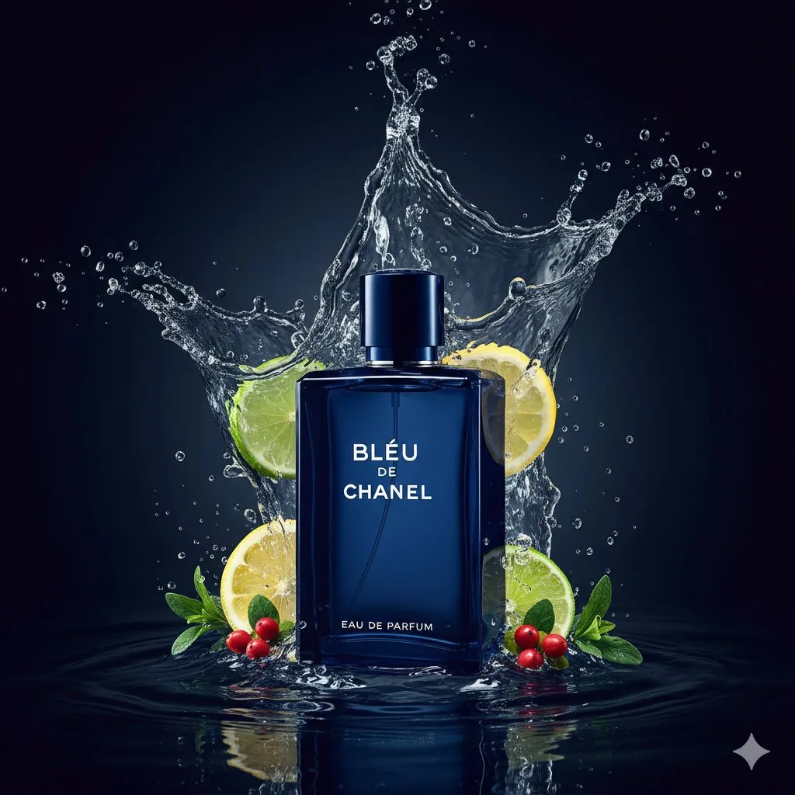

# Meem — by @mehvishs25

[← Back to Community Examples](../../EXAMPLES.md) · Category: Product & Brand · Model: `Nano Banana`

<a href="https://x.com/mehvishs25/status/2016150891678912784"></a>

Source: **[@mehvishs25 on X](https://x.com/mehvishs25/status/2016150891678912784)** · Creator: [Meem](https://x.com/mehvishs25)

## Prompt

```text
{
  "global_settings": {
    "resolution": "8K",
    "aspect_ratio": "3:4",
    "style": "photorealistic cinematic product photography",
    "detail_level": "extreme micro-detail",
    "sharpness": "ultra-sharp",
    "noise": "none",
    "compression_artifacts": "none",
    "color_depth": "rich 16-bit color",
    "render_quality": "luxury commercial grade",
    "ai_finish": "clean AI-enhanced realism"
  },

  "module_1": {
    "scene_identity": "forest_green_perfume",
    "environment": {
      "setting": "dense forest atmosphere",
      "background": "soft blurred green foliage with depth separation",
      "foreground": "natural forest floor with soil, moss, and small debris",
      "props": [
        "flat natural stone platform",
        "irregular rock placed slightly behind the bottle",
        "pine tree branches with visible needles on the right side"
      ],
      "atmosphere": "soft drifting smoke or mist rising behind the bottle"
    },
    "product": {
      "object_type": "perfume bottle",
      "material": "ribbed translucent glass",
      "color": "deep emerald green liquid",
      "shape": "cylindrical with vertical grooves",
      "cap": {
        "material": "metal",
        "finish": "polished gold",
        "shape": "smooth cylindrical"
      },
      "label": "no visible branding text"
    },
    "lighting": {
      "key_light": "soft diffused natural light from front-left",
      "fill_light": "subtle ambient forest light",
      "highlights": "gentle reflections on glass ribs and gold cap",
      "shadows": "soft realistic shadows under bottle and rocks"
    },
    "camera": {
      "angle": "eye-level product angle",
      "focus": "sharp focus on bottle, shallow depth of field",
      "lens_effect": "natural bokeh background"
    },
    "mood": "fresh, woody, calm, premium, nature-inspired"
  },

  "module_2": {
    "scene_identity": "blue_water_splash_perfume",
    "environment": {
      "setting": "dark aquatic studio scene",
      "background": "deep navy to black gradient",
      "surface": "rippling water with reflective highlights",
      "motion_elements": [
        "large upward water splash behind bottle",
        "floating water droplets suspended mid-air"
      ],
      "props": [
        "lemon slices (yellow flesh visible)",
        "green citrus slice",
        "small red berries",
        "green herb sprigs"
      ]
    },
    "product": {
      "object_type": "perfume bottle",
      "material": "opaque glass",
      "color": "deep midnight blue",
      "shape": "rectangular with sharp edges",
      "cap": {
        "material": "matching dark glass",
        "shape": "cylindrical"
      },
      "text_visible": [
        "BLEU DE CHANEL",
        "EAU DE PARFUM"
      ]
    },
    "lighting": {
      "key_light": "strong directional light from upper front",
      "rim_light": "cool highlights on water splash",
      "reflections": "specular highlights on glass and water surface"
    },
    "camera": {
      "angle": "slightly tilted dynamic angle",
      "focus": "sharp on bottle and splash",
      "motion_freeze": "high-speed capture look"
    },
    "mood": "fresh, energetic, aquatic, luxury fragrance ad"
  }
```

## Try it

Paste the prompt into **[vinano.ai](https://vinano.ai?utm_source=github&utm_medium=readme&utm_campaign=awesome-image-video-prompts-updating&utm_content=x-page-try)** to generate your own version.

> The image and prompt belong to @mehvishs25 ([original post](https://x.com/mehvishs25/status/2016150891678912784)) and are shown here with credit for reference. Creators can ask for changes or removal by opening an issue.
