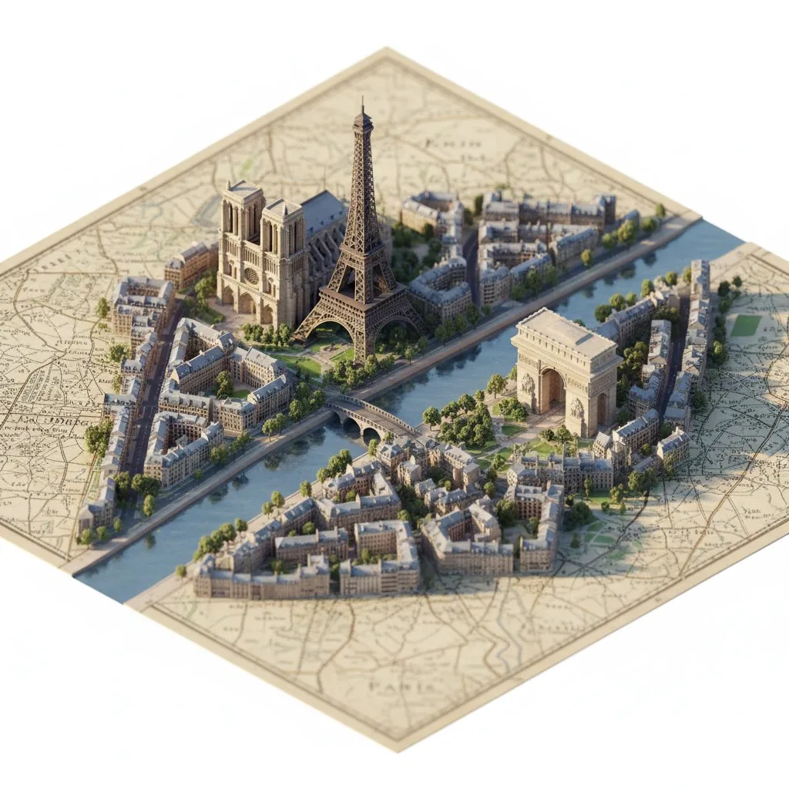

# Sharon Riley — by @Just_sharon7

[← Back to Community Examples](../../EXAMPLES.md) · Category: Illustration & 3D · Model: `Nano Banana`

<a href="https://x.com/Just_sharon7/status/2016087583999361297"></a>

Source: **[@Just_sharon7 on X](https://x.com/Just_sharon7/status/2016087583999361297)** · Creator: [Sharon Riley](https://x.com/Just_sharon7)

## Prompt

```text
{
"description": "Create a highly detailed, photorealistic miniature diorama style isometric map of [CITY/LOCATION] placed on a vintage textured paper map.",
  "perspective": {
    "type": "isometric",
    "angle": "45 degree top down",
    "look": "macro photography with tilt-shift miniature effect"
  },
  "geography": {
    "shape": "follows real geographic shape of [CITY/LOCATION]",
    "landmarks": {
      "oversized": true,
      "dominant": true,
      "primary_focus": "monuments",
      "secondary_elements": "smaller and simplified"
    },
    "architecture": "ultra detailed miniature",
    "roads": "selective",
    "greenery": true,
    "water_bodies": true,
    "terrain": true,
    "materials": ["stone", "wood", "concrete", "glass", "foliage"]
  },
  "lighting": {
    "type": "soft cinematic daylight",
    "effects": ["natural shadows", "warm highlights", "subtle atmospheric depth"]
  },
  "water": {
    "rivers": true,
    "coastlines": true,
    "depth_gradients": "smooth",
    "reflections": "gentle"
  },
  "map_base": {
    "type": "old world cartographic paper",
    "features": ["visible grid lines", "paper grain", "printed place names"]
  },
  "focus": {
    "sharp_on_landmarks": true,
    "edge_falloff": "gentle"
  },
  "quality": {
    "museum_quality": true,
    "handcrafted_diorama_realism": true,
    "ultra_high_resolution": true
  },
  "background": {
    "color": "clean pure white",
    "restrictions": ["no floating text", "no logos", "no watermarks", "no futuristic or cartoon elements"]
  },
  "aspect_ratio": "4:5"
}
```

## Try it

Paste the prompt into **[vinano.ai](https://vinano.ai?utm_source=github&utm_medium=readme&utm_campaign=awesome-image-video-prompts-updating&utm_content=x-page-try)** to generate your own version.

> The image and prompt belong to @Just_sharon7 ([original post](https://x.com/Just_sharon7/status/2016087583999361297)) and are shown here with credit for reference. Creators can ask for changes or removal by opening an issue.
