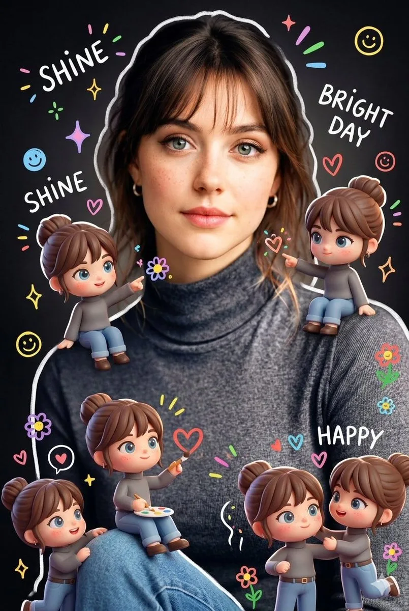

# simeon-sanai — by @Naiknelofar788

[← Back to Community Examples](../../EXAMPLES.md) · Category: Illustration & 3D · Model: `Nano Banana`

<a href="https://x.com/Naiknelofar788/status/2030296182745170292"></a>

Source: **[@Naiknelofar788 on X](https://x.com/Naiknelofar788/status/2030296182745170292)** · Creator: [simeon-sanai](https://x.com/Naiknelofar788)

## Prompt

```text
Surrounding the realistic main subject are multiple cute, 3D-style chibi miniatures of the same person, with identical facial features, hairstyle, body proportions, and outfit. 
The chibi figures are naturally distributed around the subject, interacting playfully with her or nearby elements in a charming, non-intrusive way.

Overlay the image with vibrant, hand-drawn doodle effects: soft white outlines around the subject, playful sparkles, doodle hearts, tiny flowers, smiley icons, and floating white handwritten phrases like "shine", "bright day", and "happy".

The style seamlessly blends hyper-realistic photography with colorful, soft cartoon illustrations.
Keep the original face, body shape, and proportions of the main subject unchanged. aspect ratio 2:3
```

## Try it

Paste the prompt into **[vinano.ai](https://vinano.ai?utm_source=github&utm_medium=readme&utm_campaign=awesome-image-video-prompts-updating&utm_content=x-page-try)** to generate your own version.

> The image and prompt belong to @Naiknelofar788 ([original post](https://x.com/Naiknelofar788/status/2030296182745170292)) and are shown here with credit for reference. Creators can ask for changes or removal by opening an issue.
