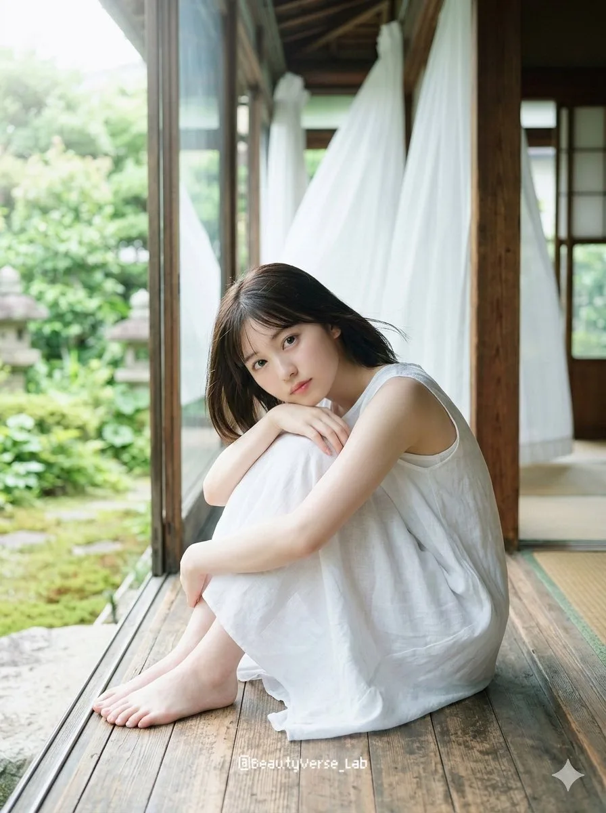

# BeautyVerse — by @BeautyVerse_Lab

[← Back to Examples from X](../../EXAMPLES.md) · Category: Photography · Model: `Nano Banana`

<a href="https://x.com/BeautyVerse_Lab/status/2027114611636572306"></a>

Original post: **[@BeautyVerse_Lab on X](https://x.com/BeautyVerse_Lab/status/2027114611636572306)** · Creator: [BeautyVerse](https://x.com/BeautyVerse_Lab)

## Prompt

```text
{
  "Character": {
    "Subject": "Japanese female idol, late teens to early 20s",
    "Face_and_Skin": "pure innocent face with translucent pale skin, glassy realistic skin texture with a subtle natural glow",
    "Makeup": "minimal 'no-makeup' look, very subtle soft pink blush, glossy clear lip balm",
    "Hair": "natural dark brown medium-length bob hair gently swaying in the breeze, no hat",
    "Eyes_and_Expression": "wide innocent soft eyes capturing the light, looking directly at camera with a gentle, ephemeral and pure expression",
    "Pose": "SITTING on a wooden engawa, HUGGING KNEES to chest, chin resting gracefully on knees, arms wrapped softly around shins, bare feet, relaxed and natural posture",
    "Outfit": "loose-fitting thin white linen summer dress, sleeveless, slightly translucent fabric catching the backlight, delicate collarbone visible, pure and ethereal all-white aesthetic"
  },
  "Scene": {
    "Environment": "wooden engawa (traditional Japanese veranda), traditional Japanese house with sliding glass doors open to a lush green summer garden",
    "Details": "bright white sheer curtains blowing in the background, soft green, brown, and white color palette",
    "Atmosphere": "clear summer morning breeze, nostalgic and ephemeral atmosphere, feeling the gentle summer breeze"
  },
  "Photography": {
    "Style": "Japanese idol photobook (shashin-shu), airy and transparent photography, masterpiece, best quality, photorealistic",
    "Camera_and_Lens": "Contax 645 medium format look, Carl Zeiss Planar 80mm f/2 lens, shallow depth of field, soft airy creamy bokeh, soft ethereal focus on the edges, sharp on the eyes",
    "Framing": "shot from EYE LEVEL, medium close-up framing, knee-up composition",
    "Lighting": "SOFT NATURAL DAYLIGHT, OVERCAST or DIFFUSED WINDOW LIGHT, high-key lighting (low contrast), slightly overexposed (+1 EV) for transparency, soft wrap-around light, bright square catchlights in eyes",
    "Film_Simulation_and_Color": "Fujifilm Pro 400H film simulation, pastel color grading, cool cyan-green undertones in the shadows, milky lifted blacks, soft glowing highlights without pure white clipping",
    "Effects": "fine subtle film grain (0.2), very mild vignette (0.1), soft gentle light leak from the top corner"
    "Aapect Ratio": "3:4"
  }
}
```

## Try it

Paste the prompt into **[vinano.ai](https://vinano.ai?utm_source=github&utm_medium=readme&utm_campaign=awesome-image-video-prompts-updating&utm_content=x-page-try)** to generate your own version.

> The image and prompt belong to [@BeautyVerse_Lab](https://x.com/BeautyVerse_Lab) and are shown here with credit for reference. Creators can ask for changes or removal by opening an issue.
