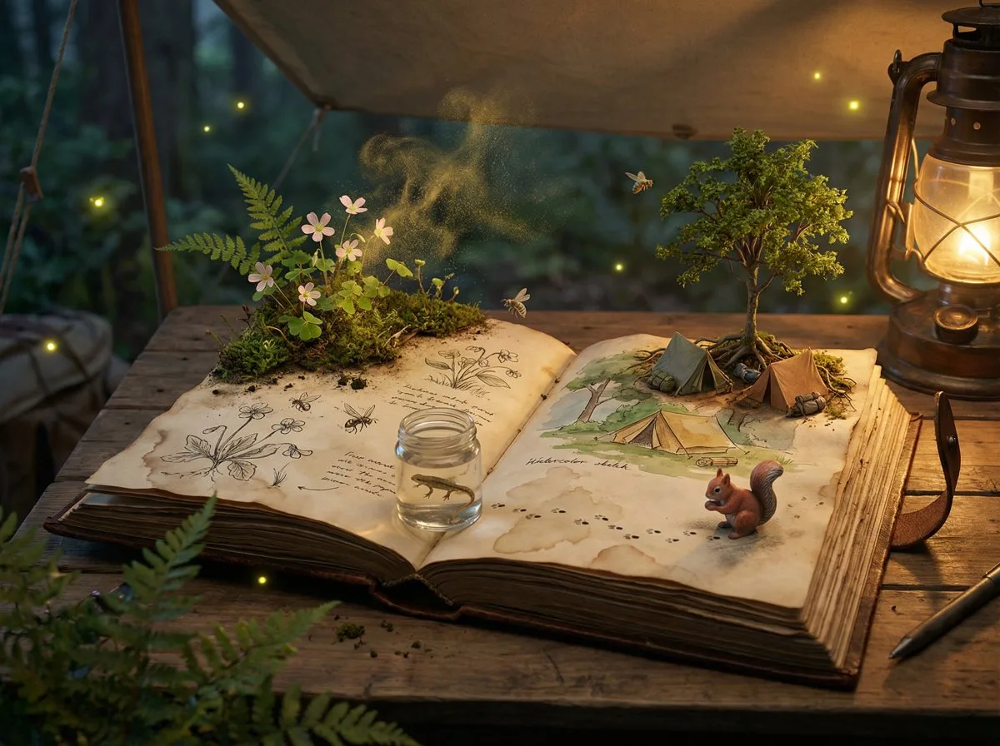

# Alexandra Aisling — by @AllaAisling

[← Back to Examples from X](../../EXAMPLES.md) · Category: Illustration & 3D · Model: `Nano Banana`

<a href="https://x.com/AllaAisling/status/2017981012614009229"></a>

Original post: **[@AllaAisling on X](https://x.com/AllaAisling/status/2017981012614009229)** · Creator: [Alexandra Aisling](https://x.com/AllaAisling)

## Prompt

```text
Epic 3D scene: a weathered field journal lies open on a naturalist's camp table, its pages erupting into the ecosystems they document. Hand-drawn botanical illustrations push upward into living specimens : [PLANT 1] unfurls actual petals, [PLANT 2] releases pollen that drifts across the spread. Pinned insect diagrams detach and take flight. Watercolor landscapes inflate into traversable terrain. Margin notes become tiny expedition camps. Pressed flowers resurrect in time-lapse bloom. A specimen jar on the page contains an actual swimming creature. Field sketches of [ANIMAL] step off the paper, leaving graphite footprints. Coffee-stained pages become amber pools. Canvas tent visible beyond, lantern light mixing with fireflies, the smell of pine and old paper, 8K, photorealistic documentary aesthetic
```

## Try it

Paste the prompt into **[vinano.ai](https://vinano.ai?utm_source=github&utm_medium=readme&utm_campaign=awesome-image-video-prompts-updating&utm_content=x-page-try)** to generate your own version.

> The image and prompt belong to [@AllaAisling](https://x.com/AllaAisling) and are shown here with credit for reference. Creators can ask for changes or removal by opening an issue.
