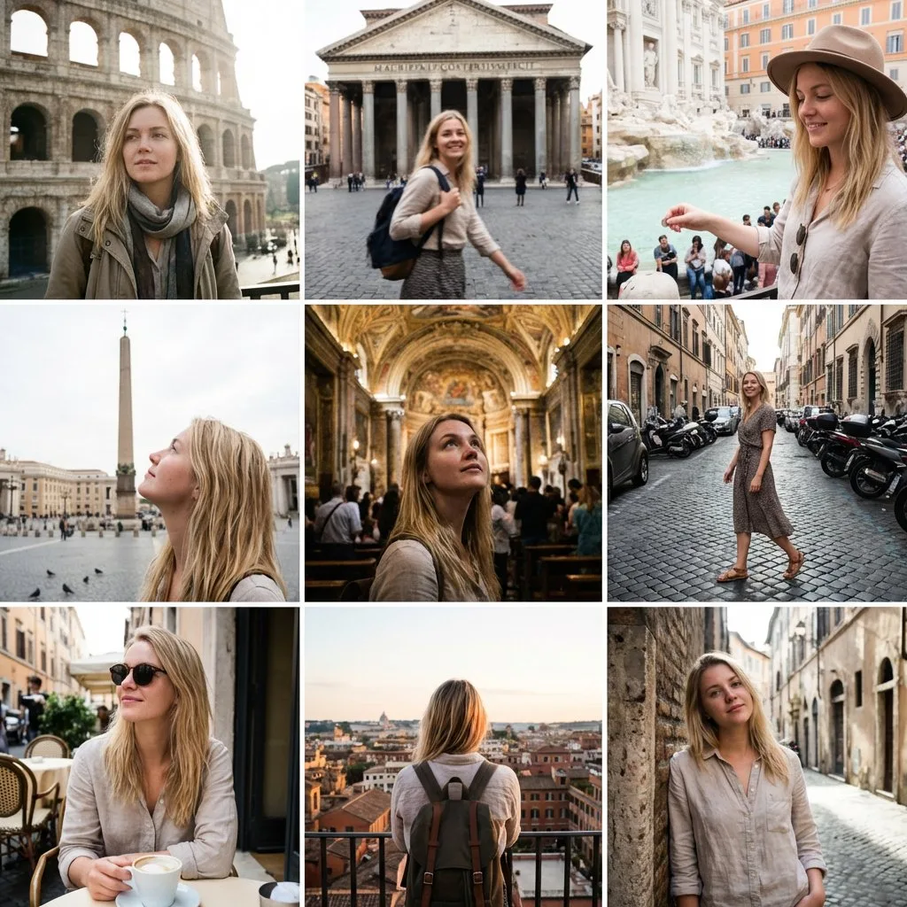

# Keskin — by @craftian_keskin

[← Back to Examples from X](../../EXAMPLES.md) · Category: Photography · Model: `Nano Banana`

<a href="https://x.com/craftian_keskin/status/2036461032651235759"></a>

Original post: **[@craftian_keskin on X](https://x.com/craftian_keskin/status/2036461032651235759)** · Creator: [Keskin](https://x.com/craftian_keskin)

## Prompt

```text
{
  "Objective": "Create a 3x3 Instagram-style grid of low-quality smartphone photos featuring the same extremely beautiful blonde woman traveling in Rome, capturing iconic landmarks with a natural, unfiltered aesthetic.",
  "Composition": {
    "layout": "3x3 grid",
    "aspect_ratio": "1:1",
    "framing": "each square is a different candid moment, forming a cohesive Instagram profile layout"
  },
  "Subject": {
    "type": "young woman",
    "appearance": {
      "hair": "blonde",
      "beauty": "extremely beautiful, natural attractiveness",
      "skin": "realistic skin texture, no glossiness, no smoothing",
      "makeup": "minimal, natural look",
      "expression": "candid, relaxed, travel lifestyle expressions"
    },
    "consistency": "same woman across all 9 photos"
  },
  "Scenes": [
    {
      "position": "top left",
      "location": "Colosseum",
      "pose": "standing casually, looking away"
    },
    {
      "position": "top center",
      "location": "Pantheon",
      "pose": "walking or mid-step candid"
    },
    {
      "position": "top right",
      "location": "Trevi Fountain (Love Fountain)",
      "pose": "throwing coin or smiling softly"
    },
    {
      "position": "middle left",
      "location": "Vatican Obelisk (St. Peter’s Square)",
      "pose": "looking up at architecture"
    },
    {
      "position": "middle center",
      "location": "Sistine Chapel",
      "pose": "looking upward, subtle awe expression"
    },
    {
      "position": "middle right",
      "location": "Roman city street",
      "pose": "walking candid, street lifestyle"
    },
    {
      "position": "bottom left",
      "location": "Roman cafe street",
      "pose": "sitting casually, relaxed"
    },
    {
      "position": "bottom center",
      "location": "panoramic cityscape viewpoint",
      "pose": "back facing camera, overlooking city"
    },
    {
      "position": "bottom right",
      "location": "historic Roman alley or landmark",
      "pose": "leaning or standing naturally"
    }
  ],
  "Photography": {
    "camera": "smartphone",
    "style": "Instagram casual travel",
    "quality": "intentionally low quality",
    "lighting": "natural sunlight, uneven exposure",
    "imperfections": [
      "motion blur",
      "grain/noise",
      "slight overexposure or underexposure",
      "lens distortion",
      "unbalanced framing"
    ],
    "effects": [
      "no beauty filter",
      "no skin retouching",
      "authentic dynamic range",
      "slightly washed or inconsistent colors"
    ]
  },
  "Mood": "carefree travel, European summer, candid lifestyle",
  "Rendering": {
    "style_keywords": [
      "instagram grid",
      "rome travel photos",
      "smartphone photography",
      "low quality aesthetic",
      "natural beauty",
      "tourist lifestyle"
    ],
    "realism": "highly realistic smartphone look",
    "detail_level": "natural imperfect detail",
    "aspect_ratio": "--ar 1:1"
  },
  "Response_Format": {
    "type": "image_generation_prompt_json",
    "editable_fields": [
      "scenes",
      "lighting",
      "poses",
      "wardrobe"
    ]
  }
}
```

## Try it

Paste the prompt into **[vinano.ai](https://vinano.ai?utm_source=github&utm_medium=readme&utm_campaign=awesome-image-video-prompts-updating&utm_content=x-page-try)** to generate your own version.

> The image and prompt belong to [@craftian_keskin](https://x.com/craftian_keskin) and are shown here with credit for reference. Creators can ask for changes or removal by opening an issue.
