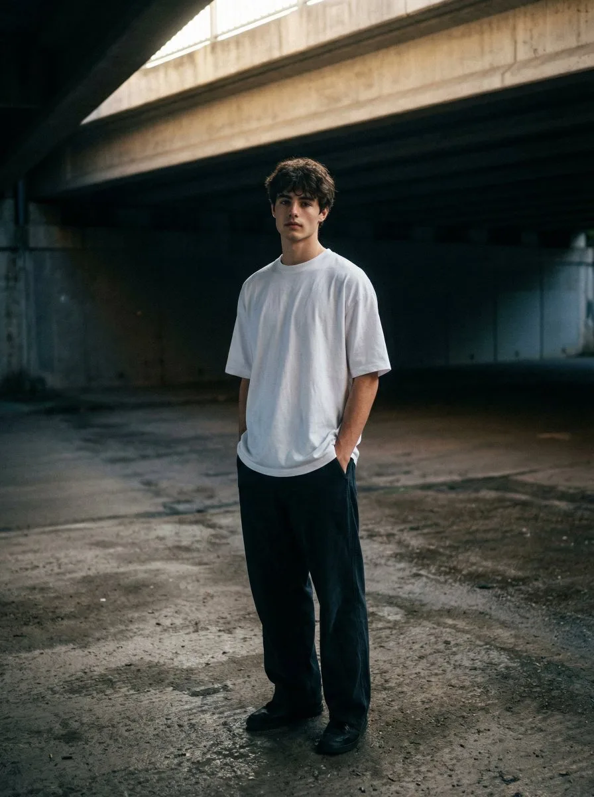

# Harboriis — by @harboriis

[← Back to Examples from X](../../EXAMPLES.md) · Category: Photography · Model: `Nano Banana`

<a href="https://x.com/harboriis/status/2019239504922784189"></a>

Original post: **[@harboriis on X](https://x.com/harboriis/status/2019239504922784189)** · Creator: [Harboriis](https://x.com/harboriis)

## Prompt

```text
A moody, urban portrait of me standing under a desolate concrete overpass, the harsh architectural lines framing a lone figure. I'm wear ing an oversized white t-shirt and loose dark pants, hands in pockets, a relaxed posture. The ground is rough, textured concrete, with hints of dampness. Cinematic top lighting with deep shadows and rich tex ture, emphasizing the starkness of the environment.

Shot on 35mm, f/2.8, ISO 400, 1/125s. Apply Fuji Classic Chrome preset with warm highlights, strong contrast, slight desaturation, light film grain, and soft vignette for a nostalgic, поп-blue tone look.
```

## Try it

Paste the prompt into **[vinano.ai](https://vinano.ai?utm_source=github&utm_medium=readme&utm_campaign=awesome-image-video-prompts-updating&utm_content=x-page-try)** to generate your own version.

> The image and prompt belong to [@harboriis](https://x.com/harboriis) and are shown here with credit for reference. Creators can ask for changes or removal by opening an issue.
