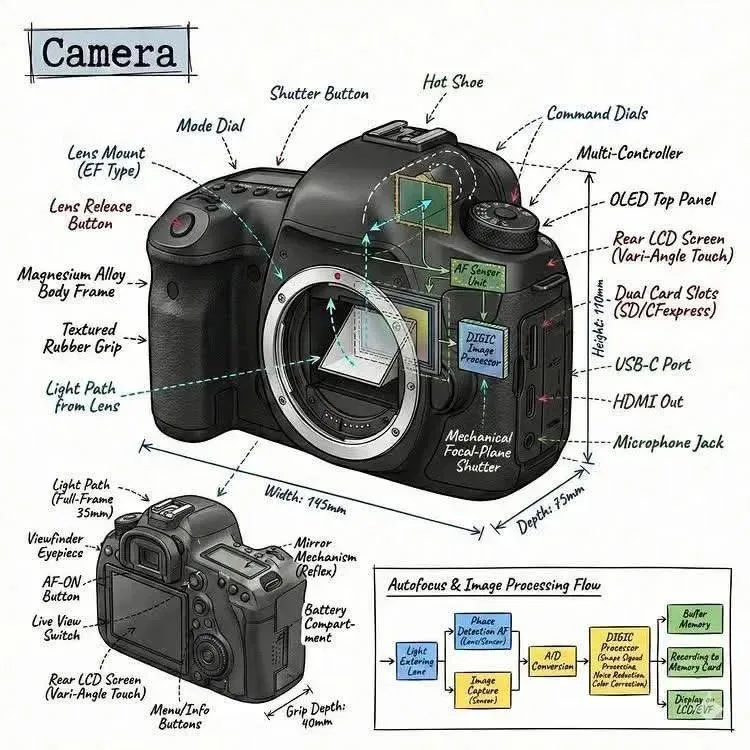

# Tips Excel — by @gudanglifehack

[← Back to Community Examples](../../EXAMPLES.md) · Category: UI & Graphic · Model: `Nano Banana`

<a href="https://x.com/gudanglifehack/status/2038346918406115788"></a>

Source: **[@gudanglifehack on X](https://x.com/gudanglifehack/status/2038346918406115788)** · Creator: [Tips Excel](https://x.com/gudanglifehack)

## Prompt

```text
Create an infographic image of [OBJECT], combining a realistic photograph or photorealistic render of the object with technical annotation overlays placed directly on top. Use black ink–style line drawings and text (technical pen / architectural sketch look) on a pure white studio background. Include: •Key component labels •Internal cutaway or exploded-view outlines (where relevant) •Measurements, dimensions, and scale markers •Material callouts and quantities
```

## Try it

Paste the prompt into **[vinano.ai](https://vinano.ai?utm_source=github&utm_medium=readme&utm_campaign=awesome-image-video-prompts-updating&utm_content=x-page-try)** to generate your own version.

> The image and prompt belong to @gudanglifehack ([original post](https://x.com/gudanglifehack/status/2038346918406115788)) and are shown here with credit for reference. Creators can ask for changes or removal by opening an issue.
