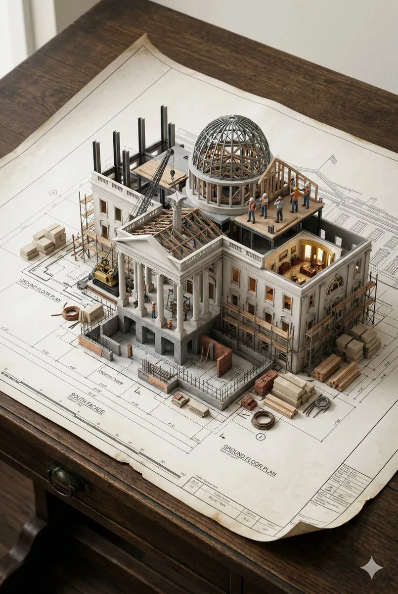

# 两斤 — by @0x00_Krypt

[← Back to Community Examples](../../EXAMPLES.md) · Category: Illustration & 3D · Model: `Nano Banana`

<a href="https://x.com/0x00_Krypt/status/2027644159285465175"></a>

Source: **[@0x00_Krypt on X](https://x.com/0x00_Krypt/status/2027644159285465175)** · Creator: [两斤](https://x.com/0x00_Krypt)

## Prompt

```text
An architectural blueprint of [BUILDING_NAME] placed on a {SURFACE}, with a photorealistic miniature under-construction version of [BUILDING_NAME] emerging from it — [STRUCTURAL_ELEMENT_1], [STRUCTURAL_ELEMENT_2], [STRUCTURAL_ELEMENT_3], [CONSTRUCTION_DETAIL], {WORKER_SCENE}, {MATERIAL_ELEMENT}, and {EXTRA_DETAIL}. All elements grow from the blueprint like a 3D architectural diorama, steel beams rising from the drawn lines, scaffolding threading through the paper. Studio soft lighting, cinematic depth
```

## Try it

Paste the prompt into **[vinano.ai](https://vinano.ai?utm_source=github&utm_medium=readme&utm_campaign=awesome-image-video-prompts-updating&utm_content=x-page-try)** to generate your own version.

> The image and prompt belong to @0x00_Krypt ([original post](https://x.com/0x00_Krypt/status/2027644159285465175)) and are shown here with credit for reference. Creators can ask for changes or removal by opening an issue.
