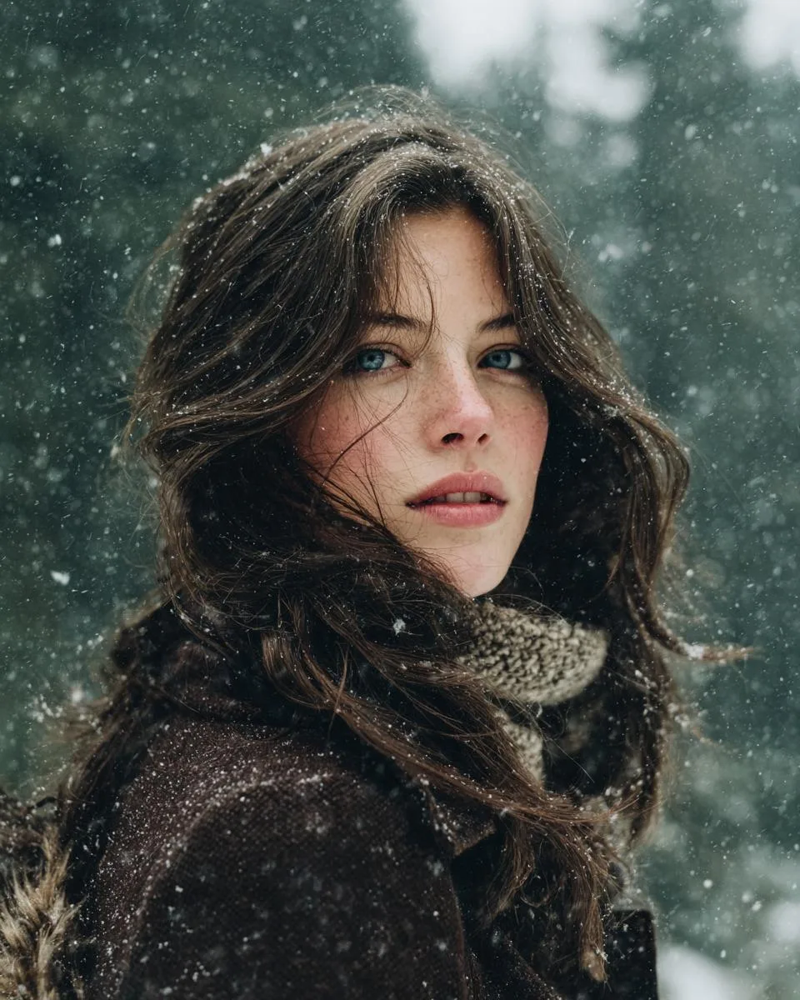

# Taaruk — by @Taaruk_

[← Back to Community Examples](../../EXAMPLES.md) · Category: Photography · Model: `Nano Banana`

<a href="https://x.com/Taaruk_/status/2008379371405668478"></a>

Source: **[@Taaruk_ on X](https://x.com/Taaruk_/status/2008379371405668478)** · Creator: [Taaruk](https://x.com/Taaruk_)

## Prompt

```text
{
  "Objective": "Generate a cinematic, photorealistic portrait inspired by a winter forest atmosphere",
  "PersonaDetails": {
    "Subject": "Young woman",
    "Appearance": {
      "Hair": "Long, wavy dark brown hair, slightly windblown",
      "Eyes": "Light blue",
      "Skin": "Fair with natural freckles",
      "Expression": "Soft, introspective, slightly wistful"
    },
    "Clothing": {
      "Outerwear": "Dark brown wool coat",
      "Accessories": "Knitted scarf in neutral tones"
    }
  },
  "SceneDescription": {
    "Environment": "Snowy forest with soft-focus evergreen trees",
    "Weather": "Gentle snowfall",
    "Season": "Winter",
    "Mood": "Quiet, cinematic, melancholic, ethereal"
  },
  "PhotographyStyle": {
    "Type": "Cinematic portrait photography",
    "Lighting": "Soft natural light, overcast winter lighting",
    "DepthOfField": "Shallow depth of field with creamy bokeh",
    "CameraAngle": "Three-quarter profile, subject looking back over shoulder",
    "Resolution": "Ultra high resolution, sharp facial details"
  },
  "ArtDirection": {
    "ColorPalette": "Muted earth tones, cool greens and soft whites",
    "Texture": "Natural skin texture, visible snow particles",
    "RealismLevel": "Highly photorealistic"
  },
  "NegativePrompt": [
    "cartoon",
    "anime",
    "overly smooth skin",
    "harsh lighting",
    "blurry face",
    "distorted anatomy",
    "oversaturated colors"
  ],
  "ResponseFormat": {
    "Type": "Single image",
    "Orientation": "Portrait",
    "AspectRatio": "2:3"
  }
}
```

## Try it

Paste the prompt into **[vinano.ai](https://vinano.ai?utm_source=github&utm_medium=readme&utm_campaign=awesome-image-video-prompts-updating&utm_content=x-page-try)** to generate your own version.

> The image and prompt belong to @Taaruk_ ([original post](https://x.com/Taaruk_/status/2008379371405668478)) and are shown here with credit for reference. Creators can ask for changes or removal by opening an issue.
