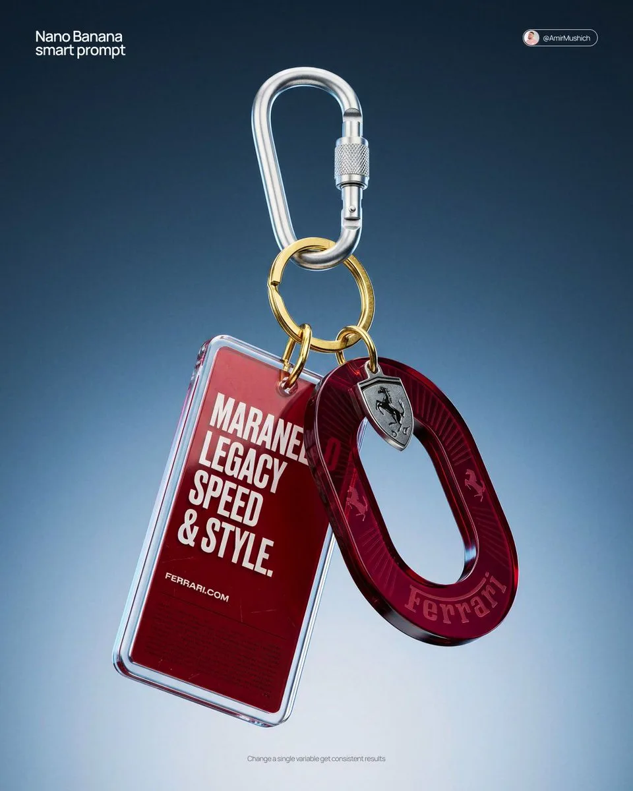

# AmirMušić — by @AmirMushich

[← Back to Community Examples](../../EXAMPLES.md) · Category: Illustration & 3D · Model: `Nano Banana`

<a href="https://x.com/AmirMushich/status/2036519680291049494"></a>

Source: **[@AmirMushich on X](https://x.com/AmirMushich/status/2036519680291049494)** · Creator: [AmirMušić](https://x.com/AmirMushich)

## Prompt

```text
[BRAND NAME]
Act as a High-End CGI Product Photographer and 3D Render Artist
specializing in streetwear merch and limited-edition collectibles.

PHASE 1: CONCEPT & OBJECT

Create a photorealistic CGI product shot of a premium keychain set
suspended in mid-air against a neutral gradient studio background.
The keychain set consists of THREE elements connected to a single
polished silver carabiner clip with a gold-plated split ring:

ELEMENT 1 — ACRYLIC TAG:

A rectangular acrylic charm (approx. 4:9 ratio, rounded corners, 3mm thick).
Layered construction: clear gloss acrylic front panel over a [BRAND NAME]-colored
background insert. The background insert carries bold, condensed all-caps
typography — autonomously generate a short poetic or brand-relevant phrase
(4–8 words) that matches [BRAND NAME]'s tone of voice, set in a heavy
condensed grotesque typeface (Bebas Neue / Impact / custom bold). Include
[BRAND NAME]'s URL or tagline in small print at the bottom of the insert.
Micro-printed fine text fills the lower third as a design texture element.

ELEMENT 2 — OVAL MEDALLION CHARM:

A die-cut oval hoop/ring shape (donut silhouette, 40mm diameter) made from
tinted translucent acrylic or resin. Autonomously determine the iconic
brand color of [BRAND NAME] and apply it as the tint (deep saturated,
jewel-tone translucency — e.g., gold, cobalt, emerald, crimson).
The [BRAND NAME] wordmark is engraved or UV-printed in bold all-caps
along the inner curve of the ring. Add 1–2 small iconographic symbols
(logo mark, globe icon, cloud glyph) laser-engraved onto the face.
Subtle radial sun-ray pattern embossed on the surface.

ELEMENT 3 — HARDWARE:

Silver anodized aluminum carabiner with knurled locking barrel.
Gold-plated brass split ring (key ring loop) at the top.
All metal surfaces show micro-scratches and machining marks —
no perfect CGI plastic. Industrial precision aesthetic.

PHASE 2: MATERIAL & TEXTURE

Render all acrylic elements with full Ray Tracing and Subsurface
Scattering — light must visibly pass through the tinted acrylic
creating internal glow. Apply Fresnel reflection on acrylic edges.
Surface imperfections: hairline scratches, micro-dust particles,
smudge traces on the clear panel (subtle, editorial-level — not dirty).
Metal: PBR metallic workflow — anisotropic specular highlights on
the carabiner barrel, brushed finish on the ring.
Typography on acrylic must appear screen-printed or UV spot-coated —
slight ink texture, not floating.

PHASE 3: COMPOSITION & STAGING

Levitation shot: the entire keychain set hangs suspended from the
top of frame, centered with a 10–15 degree rotation to the right
(showing dimensionality). Nothing touches a surface — pure float.
Camera angle: slightly below eye-level looking up at ~5 degrees,
portrait orientation (4:5 ratio).
Depth of Field: focus plane centered on the oval medallion,
acrylic tag in sharp secondary focus, top hardware with micro
bokeh blur. Aperture equivalent: f/4.0.
Negative space: generous — object occupies 55% of frame.

PHASE 4: LIGHTING

Primary: large octabox soft key light, positioned top-right at
45 degrees — creates clean specular bloom on acrylic edges.
Secondary: subtle rim light from bottom-left, cool temperature
(5500K), separates the object from background.
Background: seamless gradient cyclorama — dark steel blue (#1a2535)
at top transitioning to pale silver-grey (#d0d8e0) at bottom.
No hard shadows cast. Global Illumination active.
Chromatic Aberration: micro-level, visible only on acrylic edges
(adds realism, prevents CGI-plastic look).
No lens flare. No neon. No HDR overblown highlights.

TECH SPECS

Render engine: Octane Render or Blender Cycles (path-traced)
Resolution: 4096 x 5120px (4:5 portrait)
Samples: 4096 minimum
Color profile: Adobe RGB, D65 white point
Post-processing: subtle film grain overlay (ISO 400 equivalent),
+5 clarity, -10 highlights, neutral color grade
Output mood: High-end streetwear lookbook / limited drop product page
Style references: Kith accessories, Highsnobiety product editorial,
Fragment Design merch photography
NEGATIVE: No white studio infinity cove. No flat lay. No hand holding
the product. No fake bokeh blur filters. No AI plastic sheen.
No floating text outside the object.
```

## Try it

Paste the prompt into **[vinano.ai](https://vinano.ai?utm_source=github&utm_medium=readme&utm_campaign=awesome-image-video-prompts-updating&utm_content=x-page-try)** to generate your own version.

> The image and prompt belong to @AmirMushich ([original post](https://x.com/AmirMushich/status/2036519680291049494)) and are shown here with credit for reference. Creators can ask for changes or removal by opening an issue.
