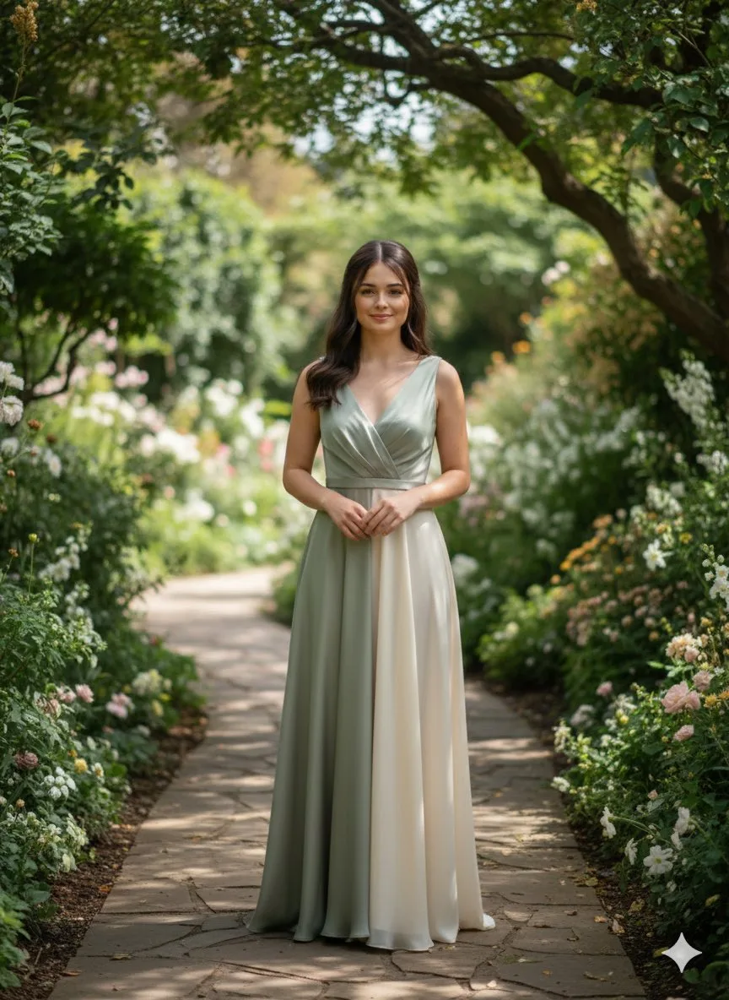

# Hoor — by @hoor_world06

[← Back to Community Examples](../../EXAMPLES.md) · Category: Photography · Model: `Nano Banana`

<a href="https://x.com/hoor_world06/status/2007722778032484576"></a>

Source: **[@hoor_world06 on X](https://x.com/hoor_world06/status/2007722778032484576)** · Creator: [Hoor](https://x.com/hoor_world06)

## Prompt

```text
{
  "render_goal": "Natural cinematic garden portrait with timeless elegance",
  "subject": {
    "pose": "female standing naturally on a garden path, relaxed posture",
    "expression": "calm composed confidence with a genuine soft smile"
  },
  "wardrobe": "elegant silk chiffon gown in muted sage or soft ivory, minimal drape, realistic fabric weight, subtle movement, no shimmer, no fantasy elements",
  "environment": {
    "location": "lush botanical garden in daylight",
    "props": "realistic flowers and greenery, natural sunlight filtering through leaves, gentle shadows, earthy tones, organic depth of field"
  },
  "camera_style": "cinematic photography, 50mm lens look, shallow depth of field, natural skin texture, realistic color grading, film-like softness"
}
```

## Try it

Paste the prompt into **[vinano.ai](https://vinano.ai?utm_source=github&utm_medium=readme&utm_campaign=awesome-image-video-prompts-updating&utm_content=x-page-try)** to generate your own version.

> The image and prompt belong to @hoor_world06 ([original post](https://x.com/hoor_world06/status/2007722778032484576)) and are shown here with credit for reference. Creators can ask for changes or removal by opening an issue.
