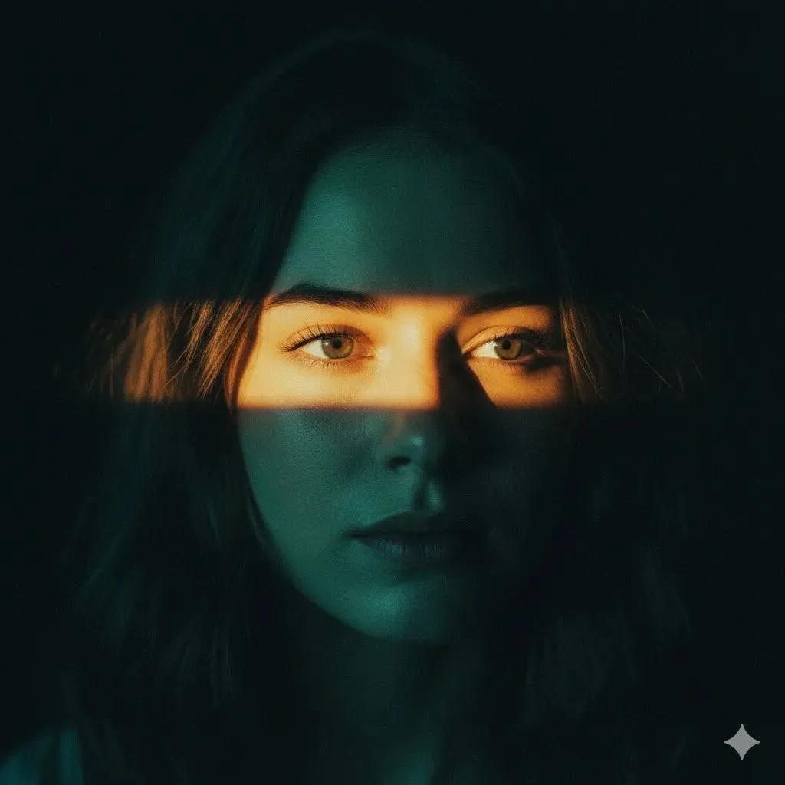

# Kashberg — by @Kashberg_0

[← Back to Examples from X](../../EXAMPLES.md) · Category: Photography · Model: `Nano Banana`

<a href="https://x.com/Kashberg_0/status/2026212158548369776"></a>

Original post: **[@Kashberg_0 on X](https://x.com/Kashberg_0/status/2026212158548369776)** · Creator: [Kashberg](https://x.com/Kashberg_0)

## Prompt

```text
Ultra-realistic cinematic portrait of a young woman with soft brown hair, centered composition, dark moody background, dramatic horizontal strip of warm golden sunlight cutting across her eyes, teal and orange color grading, half of the face in deep shadow, intense eye contact, sharp facial details, soft skin texture, high contrast lighting, volumetric light beam effect, shallow depth of field, 85mm lens, f/1.8, studio quality, symmetrical framing, mysterious atmosphere, 4K, hyper-detailed.
```

## Try it

Paste the prompt into **[vinano.ai](https://vinano.ai?utm_source=github&utm_medium=readme&utm_campaign=awesome-image-video-prompts-updating&utm_content=x-page-try)** to generate your own version.

> The image and prompt belong to [@Kashberg_0](https://x.com/Kashberg_0) and are shown here with credit for reference. Creators can ask for changes or removal by opening an issue.
