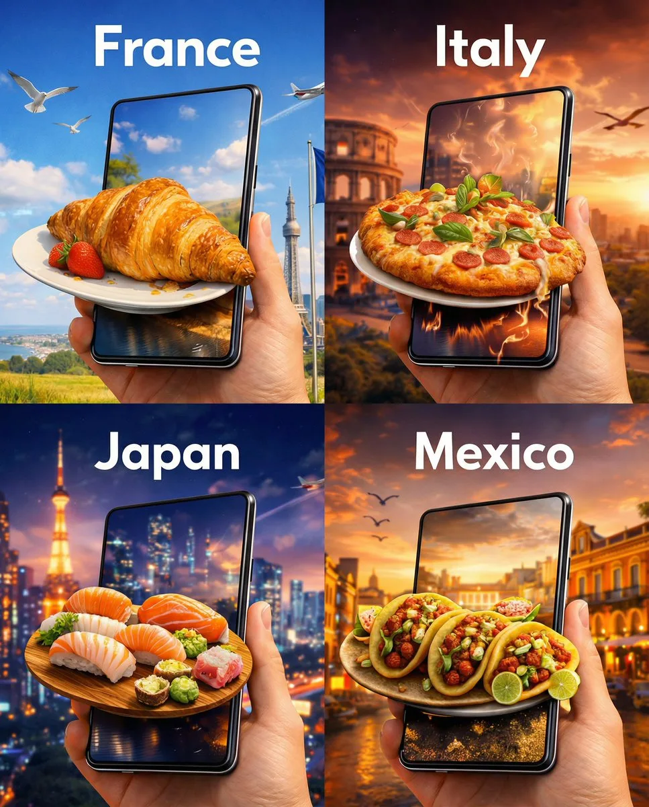

# 𝐌 — by @Strength04_X

[← Back to Examples from X](../../EXAMPLES.md) · Category: Food & Drink · Model: `Nano Banana`

<a href="https://x.com/Strength04_X/status/2019701962959372771"></a>

Original post: **[@Strength04_X on X](https://x.com/Strength04_X/status/2019701962959372771)** · Creator: [𝐌](https://x.com/Strength04_X)

## Prompt

```text
{
   "Create a hyper-realistic tourism advertisement collage in a single 1:1 image divided into a 2x2 grid. Each section shows a hand holding a sleek, ultra-thin smartphone in portrait orientation, slightly tilted to create a strong 3D portal effect where iconic national food emerges out of the phone screen into the real world. Consistent hand, phone design, and lighting style across all four panels.",
  "layout": {
    "type": "grid",
    "rows": 2,
    "columns": 2,
    "aspect_ratio": "1:1"
  },
  "scenes": [
    {
      "position": "top-left",
      "country": "France",
      "text": "France",
      "food": "Golden buttery croissant on a white plate with strawberries",
      "background": "Eiffel Tower, green fields, bright blue sky",
      "elements": ["flying birds", "commercial airplane", "French flag"],
      "lighting": "warm natural daylight",
      "mood": "fresh, elegant, classic"
    },
    {
      "position": "top-right",
      "country": "Italy",
      "text": "Italy",
      "food": "Hot Italian pizza with basil leaves and visible steam",
      "background": "Colosseum, Rome skyline at sunset",
      "elements": ["orange sky", "flying birds"],
      "lighting": "golden sunset light",
      "mood": "warm, passionate, flavorful"
    },
    {
      "position": "bottom-left",
      "country": "Japan",
      "text": "Japan",
      "food": "Assorted sushi and sashimi platter on wooden tray",
      "background": "Tokyo skyline at night with Tokyo Tower and neon lights",
      "elements": ["airplane trail", "city glow"],
      "lighting": "cool night lighting with neon highlights",
      "mood": "modern, clean, refined"
    },
    {
      "position": "bottom-right",
      "country": "Mexico",
      "text": "Mexico",
      "food": "Colorful street tacos with lime and salsa",
      "background": "Colonial Mexican street with warm sunset tones",
      "elements": ["birds flying", "festive atmosphere"],
      "lighting": "warm cinematic sunset",
      "mood": "vibrant, festive, energetic"
    }
  ],
  "style": {
    "realism": "ultra-photorealistic",
    "lighting": "cinematic",
    "depth": "strong depth of field and realistic shadows",
    "colors": "vibrant but natural tourism-ad palette",
    "quality": "4K ultra-sharp"
  },
  "constraints": {
    "no_watermark": true,
    "no_brand_logos": true,
    "no_extra_text": true,
    "clean_composition": true
  }
}
```

## Try it

Paste the prompt into **[vinano.ai](https://vinano.ai?utm_source=github&utm_medium=readme&utm_campaign=awesome-image-video-prompts-updating&utm_content=x-page-try)** to generate your own version.

> The image and prompt belong to [@Strength04_X](https://x.com/Strength04_X) and are shown here with credit for reference. Creators can ask for changes or removal by opening an issue.
