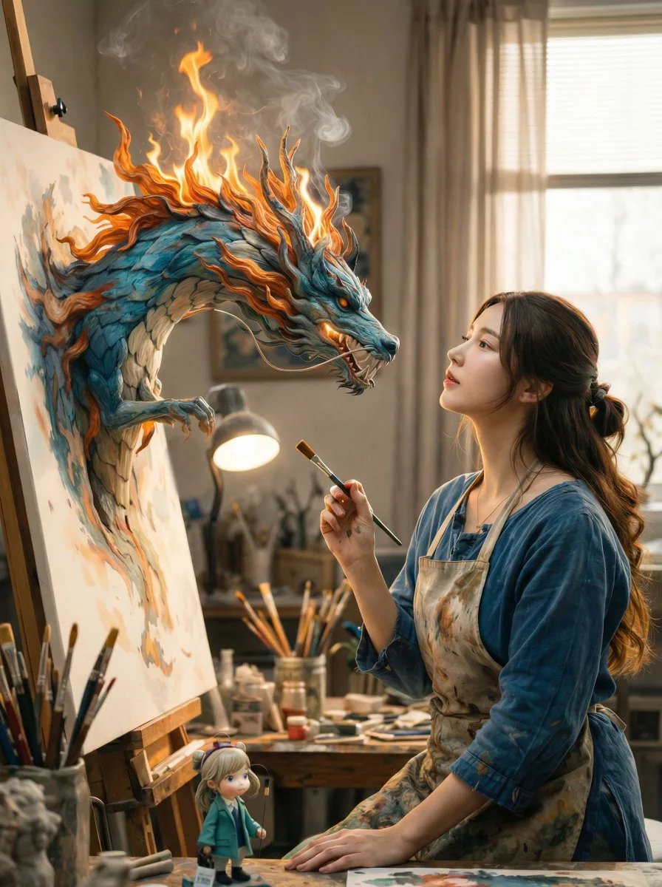

# Aijaz — by @iamsofiaijaz

[← Back to Examples from X](../../EXAMPLES.md) · Category: Photography · Model: `Nano Banana`

<a href="https://x.com/iamsofiaijaz/status/2020317156085494141"></a>

Original post: **[@iamsofiaijaz on X](https://x.com/iamsofiaijaz/status/2020317156085494141)** · Creator: [Aijaz](https://x.com/iamsofiaijaz)

## Prompt

```text
A cinematic fantasy scene inside a cozy artist’s studio. A young female painter wearing a paint-stained apron sits at an easel, holding a brush mid-air, gazing calmly at her canvas. From the canvas, a majestic Eastern-style dragon emerges in three dimensions, its scales painted in deep teal and blue hues, with flowing fiery orange flames along its mane and head, smoke curling upward. The dragon appears alive yet artistic, as if formed from brushstrokes and paint. Soft natural daylight filters through a window with sheer curtains, illuminating jars of brushes, paints, and art supplies scattered across the wooden workspace. Warm, realistic lighting, shallow depth of field, ultra-detailed textures, magical realism, fantasy realism style, 8k quality, highly detailed, cinematic composition, soft color grading, whimsical yet serene mood.
```

## Try it

Paste the prompt into **[vinano.ai](https://vinano.ai?utm_source=github&utm_medium=readme&utm_campaign=awesome-image-video-prompts-updating&utm_content=x-page-try)** to generate your own version.

> The image and prompt belong to [@iamsofiaijaz](https://x.com/iamsofiaijaz) and are shown here with credit for reference. Creators can ask for changes or removal by opening an issue.
