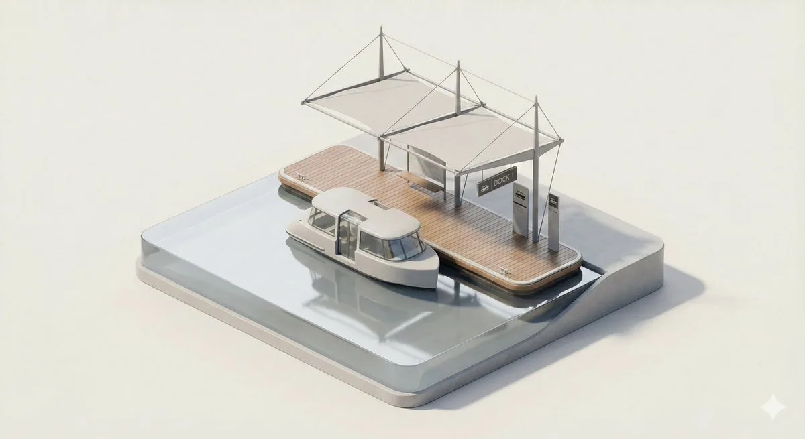

# Aleena Amir — by @aleenaamiir

[← Back to Community Examples](../../EXAMPLES.md) · Category: Illustration & 3D · Model: `Nano Banana`

<a href="https://x.com/aleenaamiir/status/2011662366141006262"></a>

Source: **[@aleenaamiir on X](https://x.com/aleenaamiir/status/2011662366141006262)** · Creator: [Aleena Amir](https://x.com/aleenaamiir)

## Prompt

```text
A clean, minimal 3D isometric diorama of a [CITY TRANSPORT TYPE] stop, featuring a [VEHICLE] paused at a [PLATFORM TYPE], simple [SHELTER / CANOPY], subtle wayfinding signs, smooth concrete surfaces, soft studio lighting, realistic materials, rounded edges, miniature architectural model style, high detail, neutral background.
```

## Try it

Paste the prompt into **[vinano.ai](https://vinano.ai?utm_source=github&utm_medium=readme&utm_campaign=awesome-image-video-prompts-updating&utm_content=x-page-try)** to generate your own version.

> The image and prompt belong to @aleenaamiir ([original post](https://x.com/aleenaamiir/status/2011662366141006262)) and are shown here with credit for reference. Creators can ask for changes or removal by opening an issue.
