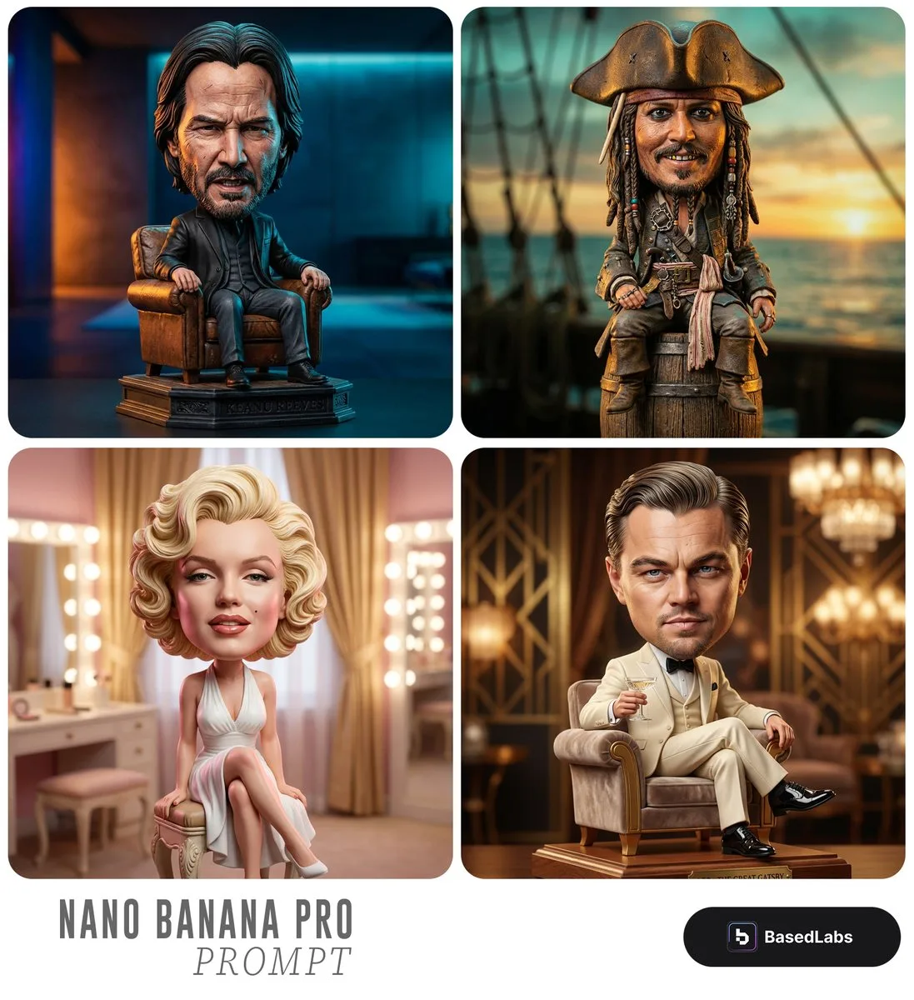

# Shams — by @ShamsAmin56

[← Back to Community Examples](../../EXAMPLES.md) · Category: Illustration & 3D · Model: `Nano Banana`

<a href="https://x.com/ShamsAmin56/status/2021519254151942239"></a>

Source: **[@ShamsAmin56 on X](https://x.com/ShamsAmin56/status/2021519254151942239)** · Creator: [Shams](https://x.com/ShamsAmin56)

## Prompt

```text
Highly detailed caricature figurine of [SUBJECT] as a cute but intense bobblehead-style collectible statue, exaggerated oversized head with hyper-realistic facial features, deep wrinkles, fierce intense expression, slightly open mouth showing teeth, sitting relaxed in a vintage armchair, wearing [OUTFIT], dramatic colorful studio lighting, [BACKGROUND], modern collectible toy photography style, sharp focus, cinematic depth of field, extremely intricate sculpting details, realistic skin texture, professional product photography, 8k quality
```

## Try it

Paste the prompt into **[vinano.ai](https://vinano.ai?utm_source=github&utm_medium=readme&utm_campaign=awesome-image-video-prompts-updating&utm_content=x-page-try)** to generate your own version.

> The image and prompt belong to @ShamsAmin56 ([original post](https://x.com/ShamsAmin56/status/2021519254151942239)) and are shown here with credit for reference. Creators can ask for changes or removal by opening an issue.
