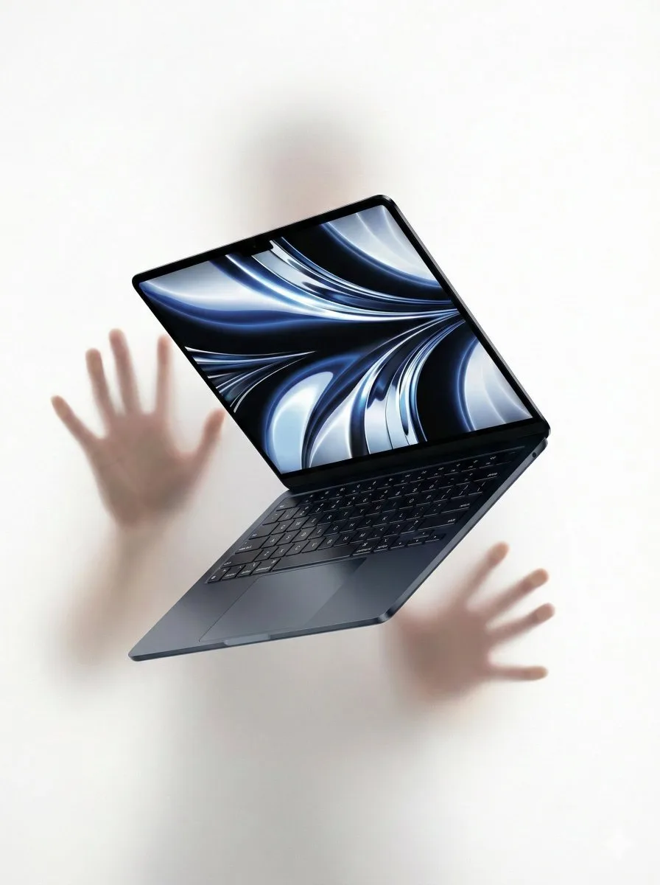

# 𝐌 — by @Strength04_X

[← Back to Community Examples](../../EXAMPLES.md) · Category: Product & Brand · Model: `Nano Banana`

<a href="https://x.com/Strength04_X/status/2021462365146116101"></a>

Source: **[@Strength04_X on X](https://x.com/Strength04_X/status/2021462365146116101)** · Creator: [𝐌](https://x.com/Strength04_X)

## Prompt

```text
{
 "task": "photorealistic_product_visual",
 "input": {
 "reference_image": "USER_UPLOADED_IMAGE",
 "preserve_product_identity": true,
 "preserve_label_text": true,
 "preserve_object_shape": true,
 "preserve_centered_composition": true
 },
 "scene": {
 "environment": "high-key studio",
 "background": "pure white seamless",
 "negative_space": "very high",
 "depth_of_field": "layered depth with strong subject isolation"
 },
 "subject": {
 "primary_object": "single product object",
 "position": "perfectly centered, floating",
 "orientation": "upright",
 "scale": "natural product scale",
 "clarity": "ultra-sharp, high micro-contrast"
 },
 "human_elements": {
 "hands": {
 "count": 2,
 "layering": "positioned behind a frosted glass surface",
 "visual_effect": "frosted glass diffusion, milky blur, softened edges",
 "transparency": "semi-opaque",
 "focus": "intentionally out of focus",
 "gesture": "slow, delicate, abstract reach",
 "interaction": "no contact with the product"
 }
 },
 "optical_effects": {
 "frosted_glass": {
 "applied_to": "hands only",
 "blur_type": "diffusion blur",
 "edge_softness": "high",
 "light_scatter": "subtle bloom"
 }
 },
 "lighting": {
 "style": "soft diffused studio lighting",
 "direction": "frontal with gentle top wash",
 "shadows": "extremely soft and minimal",
 "highlights": "clean, controlled highlights on the product only",
 "contrast": "low overall, high on product"
 },
 "materials_rendering": {
 "product_surface": "premium, realistic, tactile",
 "reflections": "clean and intentional",
 "imperfections": "none"
 },
 "aesthetic": {
 "mood": "ethereal, calm, refined",
 "style": "high-end editorial product photography",
 "visual_language": "minimal, airy, modern, poetic",
 "emotion": "care, purity, precision"
 },
 "camera": {
 "lens": "85mm",
 "aperture": "f/2.0",
 "angle": "eye-level",
 "camera_motion": "none"
 },
 "post_processing": {
 "retouching": "luxury commercial polish",
 "grain": "none",
 "color_grading": "clean whites with subtle warmth on the product"
 },
 "output": {
 "resolution": "ultra_high_resolution",
 "focus_priority": "product only",
 "clarity_separation": "product razor sharp, background and hands diffused",
 "artifacts": "none"
 }
}
```

## Try it

Paste the prompt into **[vinano.ai](https://vinano.ai?utm_source=github&utm_medium=readme&utm_campaign=awesome-image-video-prompts-updating&utm_content=x-page-try)** to generate your own version.

> The image and prompt belong to @Strength04_X ([original post](https://x.com/Strength04_X/status/2021462365146116101)) and are shown here with credit for reference. Creators can ask for changes or removal by opening an issue.
