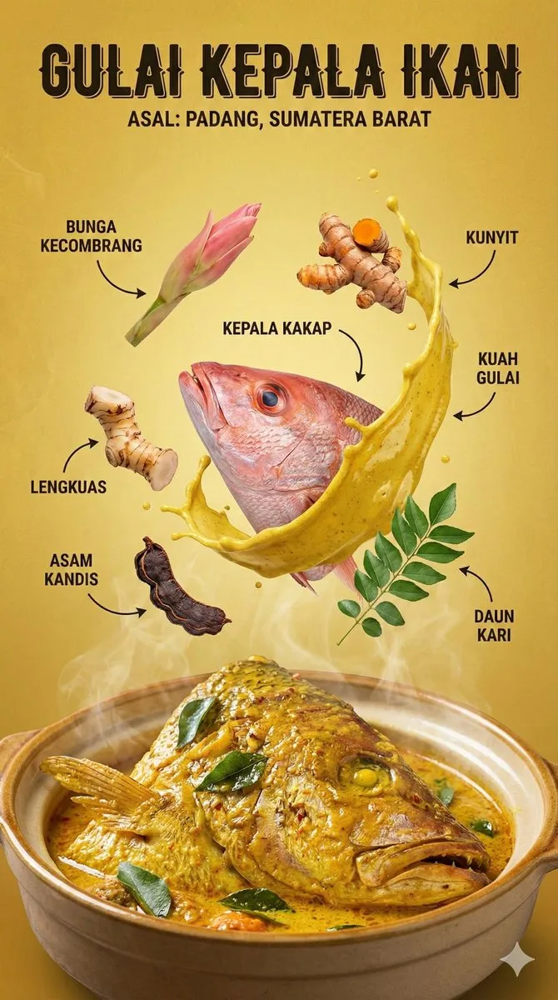

# Taaruk — by @Taaruk_

[← Back to Examples from X](../../EXAMPLES.md) · Category: Food & Drink · Model: `Nano Banana`

<a href="https://x.com/Taaruk_/status/2018252656574185981"></a>

Original post: **[@Taaruk_ on X](https://x.com/Taaruk_/status/2018252656574185981)** · Creator: [Taaruk](https://x.com/Taaruk_)

## Prompt

```text
{
  "image_prompt": {
    "type": "Ultra-realistic Indonesian traditional food infographic poster",
    "layout_and_composition": {
      "orientation": "Vertical composition",
      "style": "Modern culinary infographic design, editorial layout",
      "background": "Dramatic but clean background"
    },
    "typography_elements": {
      "headline": {
        "position": "Top",
        "style": "Bold text showing dish name and origin (ASAL)"
      },
      "labels": {
        "style": "Clean Indonesian typography",
        "connectors": "Curved label arrows pointing to ingredients"
      }
    },
    "visual_content": {
      "main_action": "Cinematic floating ingredients suspended in mid-air",
      "details": [
        "Glossy curry splash",
        "Fresh herbs",
        "Spices",
        "Steam rising from the bowl"
      ],
      "textures": "Hyper-detailed, glossy, appetizing"
    },
    "lighting_and_atmosphere": {
      "lighting_style": "Rich golden lighting, studio lighting",
      "mood": "Professional, appetizing, high-end"
    },
    "technical_specs": {
      "quality": "8K ultra-realistic, DSLR quality",
      "focus": "Shallow depth of field",
      "style": "Professional food photography"
    }
  }
}
```

## Try it

Paste the prompt into **[vinano.ai](https://vinano.ai?utm_source=github&utm_medium=readme&utm_campaign=awesome-image-video-prompts-updating&utm_content=x-page-try)** to generate your own version.

> The image and prompt belong to [@Taaruk_](https://x.com/Taaruk_) and are shown here with credit for reference. Creators can ask for changes or removal by opening an issue.
