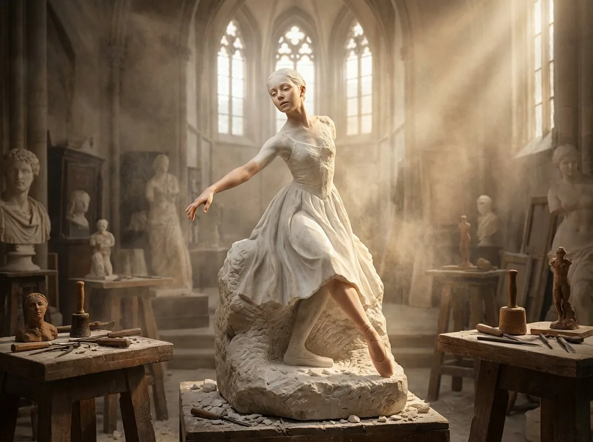

# Alexandra Aisling — by @AllaAisling

[← Back to Community Examples](../../EXAMPLES.md) · Category: Photography · Model: `Nano Banana`

<a href="https://x.com/AllaAisling/status/2010372126348284302"></a>

Source: **[@AllaAisling on X](https://x.com/AllaAisling/status/2010372126348284302)** · Creator: [Alexandra Aisling](https://x.com/AllaAisling)

## Prompt

```text
A half-finished marble sculpture in a dusty Renaissance workshop, with the [SUBJECT] emerging from the raw stone block in a breathtaking moment of creation becoming conscious. The figure is rough chisel marks at the base, transitioning through refined carving into impossibly lifelike flesh at the extremities. [KEY FEATURES] have achieved full life while the torso remains trapped in stone, mid-escape. Marble dust swirls in shaft lighting as if the awakening itself is generating atmosphere. The [SUBJECT] reaches forward, fingers transitioning from carved to living. Sculptor's tools scattered on wooden platforms: chisels, mallets, calipers, clay maquettes. Unfinished companion pieces watch from the shadows. The Pygmalion moment frozen. Cathedral-height workshop windows casting dramatic god-rays, cool marble tones warming to flesh, 8K, Bernini meets cinema.
```

## Try it

Paste the prompt into **[vinano.ai](https://vinano.ai?utm_source=github&utm_medium=readme&utm_campaign=awesome-image-video-prompts-updating&utm_content=x-page-try)** to generate your own version.

> The image and prompt belong to @AllaAisling ([original post](https://x.com/AllaAisling/status/2010372126348284302)) and are shown here with credit for reference. Creators can ask for changes or removal by opening an issue.
