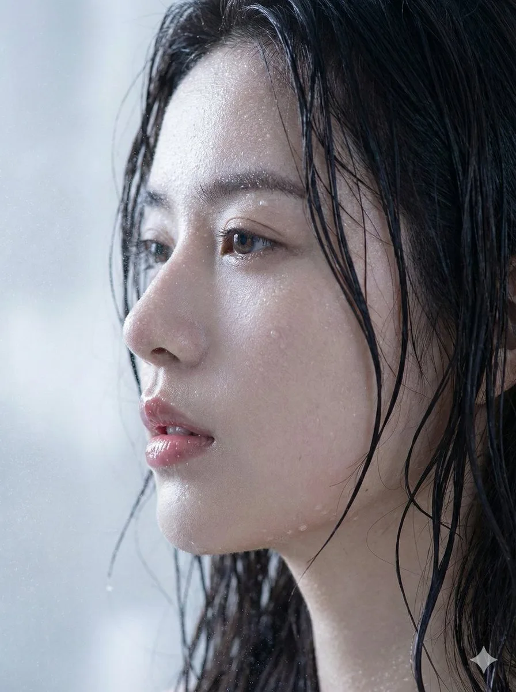

# Adam也叫吉米 — by @Adam38363368936

[← Back to Community Examples](../../EXAMPLES.md) · Category: Photography · Model: `Nano Banana`

<a href="https://x.com/Adam38363368936/status/2011356173572902941"></a>

Source: **[@Adam38363368936 on X](https://x.com/Adam38363368936/status/2011356173572902941)** · Creator: [Adam也叫吉米](https://x.com/Adam38363368936)

## Prompt

```text
{
  "request_metadata": {
    "version": "2.0",
    "priority_focus": "Hyper-realistic skin textures and identity fidelity",
    "aspect_ratio": "3:4"
  },
  "subject_configuration": {
    "identity": {
      "name": "the person I uploaded",
      "reference_mode": "strict_identity_matching",
      "source_reference": "uploaded_files",
      "preservation_weight": 1.0,
      "angle": "Extreme profile view"
    },
    "facial_attributes": {
      "eyes": {
        "reflection_type": "Realistic catchlights",
        "aesthetic_constraint": "Avoid synthetic gloss or excessive shine"
      },
      "lips": {
        "state": "Parted / Moist",
        "surface_texture": "Soft natural ridges",
        "finish": "Glossy sheen without distortion"
      },
      "hair": {
        "color": "Dark Brunette",
        "state": "Saturated / Wet",
        "styling": "Clumping in natural strands, adhered to temples and neck"
      }
    }
  },
  "environmental_rendering": {
    "moisture_fx": {
      "sweat_layer": "Fine glistening mist across the bridge of nose and forehead",
      "water_droplets": "Micro-droplets scattered on cheekbones and jawline",
      "surface_tension": "Realistic liquid adhesion to skin"
    },
    "lighting_and_color": {
      "lighting_style": "Soft-box diffusion",
      "temperature": "Cool tones",
      "color_palette": ["Steel Blue", "Soft Cyan", "Natural Skin Tones"],
      "background": {
        "description": "Minimalist bokeh",
        "colors": ["Light Grey", "Pure White"],
        "depth_of_field": "Shallow"
      }
    }
  },
  "technical_execution": {
    "rendering_engine": "CGI Photorealistic",
    "focal_length": "85mm macro",
    "texture_detail": "Pore-level resolution",
    "post_processing": "Raw photography style, no airbrushing"
  }
}
```

## Try it

Paste the prompt into **[vinano.ai](https://vinano.ai?utm_source=github&utm_medium=readme&utm_campaign=awesome-image-video-prompts-updating&utm_content=x-page-try)** to generate your own version.

> The image and prompt belong to @Adam38363368936 ([original post](https://x.com/Adam38363368936/status/2011356173572902941)) and are shown here with credit for reference. Creators can ask for changes or removal by opening an issue.
